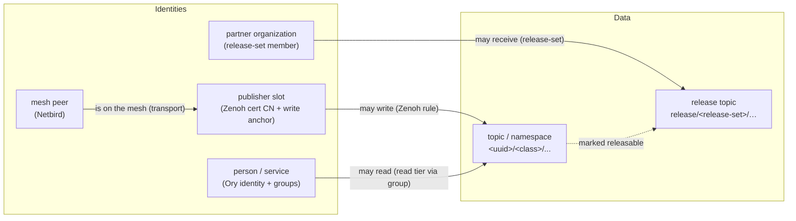
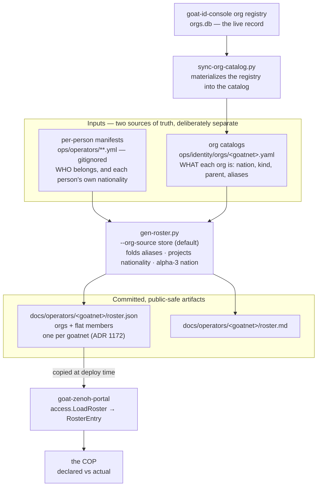

# Data-Access Common Operating Picture

**Status:** Phase 1 **in build** (server-side, goat-cli Phase G.4). Decision recorded in [ADR 1026](../adr/1026-data-access-common-operating-picture.md); build plan in [§"Build plan (Phase 1 / G.4)"](#build-plan-phase-1--g4) below. The cross-layer graph + forward/reverse query engine (`internal/access`), the `GET /api/access/who|topic|why` read API, the `why` four-layer trace, and the three-tier self-or-operator privilege model (the catch-22 resolution), and the `goat access who|topic|why` CLI over them, and the `doctor --topic` write-precheck (the active probe — sentinel write under the requester's own prefix + read-back, no COP access) are built; the web surface remains.
**Related:** [ADR 1025](../adr/1025-zenoh-dynamic-tenant-authz-slot-pool.md) (Zenoh write authorization) · [ADR 1027](../adr/1027-partner-release-set-governance.md) (partner release governance) · `identity-architecture.md` · `goat-cli.md` · `panoscope.md` · `id-admin-console.md` · `mesh-acl.md`

## What this is, in one paragraph

Access to data in this system is enforced in **four different places**: the Netbird mesh decides which machines are on the network, Ory decides which people and services are signed in and what groups they belong to, the Zenoh access-control list decides which publisher may write to which part of the topic namespace, and a separate partner-release mechanism decides which outside organizations may receive shared data. No single screen today shows the combined picture. The **Data-Access Common Operating Picture** (the "access picture") is a read-only view that pulls from all four places and answers one question in both directions: **who can access which data, and why.** It is delivered as a web surface and as a set of `goat` command-line commands. A later phase lets an administrator act from the same place — tighten, cut off, or restore access — by calling each layer's own controls.

It is the **visual arm** of the same declared-vs-actual reconciliation whose **alarm arm** is the runtime expected-vs-actual monitor ([ADR 1022](../adr/1022-zenoh-denial-observability.md)): one model of who-should-have-access versus who-actually-does, rendered as a picture here and as an alert there — not two separate systems.

## Why it is needed

Because enforcement is split across four systems, every real access question today requires a person to open four tools and correlate them by hand:

- "This partner says they cannot publish — why?" could be a revoked mesh peer, an expired Zenoh certificate, a write rule that does not cover their prefix, or a disabled Ory account. Four systems, four guesses.
- "Who can read this sensor topic?" requires reading the Zenoh read rules (community-default plus any restricted tier), the Ory groups that map to a read tier, and any partner-release marking. There is no one place that resolves it.

The access picture removes the manual correlation. It is **non-load-bearing**: it observes and (later) orchestrates the four layers, but it never enforces anything itself. If the access picture is offline, access continues to work exactly as before, because the rules still live in the four layers.

## The access graph

The view is built on a simple graph the surface assembles by reading each layer.



- **Nodes** are identities (mesh peers, Ory people/services, Zenoh publisher slots, partner organizations) and data (topic namespace regions, release topics).
- **Edges** are permissions: *is-on-the-mesh*, *may-write*, *may-read*, *belongs-to-group*, *may-receive-release*. Each edge is labeled with the layer that grants it and the specific rule or record that is the source of truth.

Each identity node is described by the **identity grammar** (ADR 1043, `identity-grammar.md`): its **role** (the capability that grants *may-write*/*may-read* edges) is distinct from its **affiliation** (the org/unit it belongs to — `kind` ∈ vendor/organic/partner/civil, hierarchical). The "org" the issuance registry below tracks **is** that affiliation dimension; the COP reads it for org-scoped attribution ("show me everything this unit can touch") without conflating it with role.

## Where the data comes from

The access picture reads from each layer's existing interface. It stores no enforcement state of its own; it caches what it reads for display and marks how fresh each piece is.

| Layer | Source read | What it contributes to the graph |
|---|---|---|
| **Netbird mesh** | Netbird management API | mesh peers, peer-to-peer access rules, which peers are currently connected |
| **Ory (Kratos + Hydra)** | Ory admin API | people and services, their group claims, active sessions |
| **Zenoh fabric** | Zenoh router admin space + the publisher slot registry held by the onboarding portal | the pre-cut write slots, each slot's write anchor (`<uuid>` — see [ADR 1025](../adr/1025-zenoh-dynamic-tenant-authz-slot-pool.md)), the read tiers, and which slot maps to which real system |
| **Partner exchange** | the release-set registry + the peering registry (see [ADR 1027](../adr/1027-partner-release-set-governance.md) outbound, [ADR 1020](../adr/1020-zenoh-federated-peering-trust-model.md) inbound) | outbound: release-sets, their member partner organizations, and which release topics are marked for which set. inbound: which quarantined data came from which external origin |
| **Issuance registry** (declared) | the per-entity manifests `ops/operators/*.yml` + the generated roster index (see [below](#the-declared-half--the-issuance-registry)) | the **declared** half: org→member structure, person→system custody, and each member's lifecycle state — the intent that the four live rows above are reconciled against |

## The declared half — the issuance registry

The four sources above are the **actual** state: what each layer is enforcing right now. They are the live half of the declared-vs-actual model. The **declared** half — what *should* be true, the intent recorded when a principal was onboarded — has no home in the four layers, because none of them records "this slot belongs to org X and was stood up by person Y." The **issuance registry** is that declared half.

It records the **principal graph** (the same structure revocation resolves against — see `credential-revocation-and-offboarding.md`, [ADR 1031](../adr/1031-credential-revocation-mesh-first-offboarding.md)):

```
org (affiliation: id · kind ∈ vendor|organic|partner|civil · nation · composition · parent · unit_code?)
  ├─ person(s)    state: active | inactive | revoked · nationality · relationship
  └─ system(s)    uuid · state · optional autonomy

  org    ──parent──▶ parent org                     (affiliation hierarchy, v1 vertical edge; ADR 1043 §4)
  person ──enrolled / responsible-for──▶ system     (custody edge: provenance, NOT ownership)
```

**An org's nation and a person's nationality are two facts on this graph, not one.** `affiliation.nation` is the nation that OWNS the organisation, typed by an admin when the org is registered. `identity.nationality` is the person's own citizenship, asked of them at intake. Neither is derived from the other and the two are permitted to disagree: a Canadian officer at a US-owned organisation carries nationality `CAN` under an org whose nation is `USA`, and that is information rather than an error ([ADR 1171](../adr/1171-person-nationality-and-org-ownership-are-two-facts.md)). `affiliation.relationship` — `constituent` / `assigned` / `liaison` — records how the person's nation relates to the organisation's, declared per membership by an admin at approval and never inferred. Alliance standing reads `affiliation.nation` only, so an organisation neither gains nor loses standing because of who is attached to it.

Persons and systems are **siblings under the org**; the person→system link is **custody, not ownership** (a person is primary at bootstrap but the system is org-owned thereafter). Each member carries its lifecycle **state** and the artifacts it was issued (mesh peer-label prefix, Ory email, Zenoh cert CN / uuid anchor).

**Source of truth + form.** The per-entity manifests under `ops/operators/*.yml` (+ per-env `ops/operators/<env>/*.yml`) are the SoT — one git-**ignored** file per person or system (identity material, backed in 1Password), carrying `type`, `identity.nationality` (the person's own citizenship), the `affiliation` block (`id`/`kind`/`nation`/`composition`/`relationship`/`parent`), `enrolled_by`, the issued artifacts, and the `status` field the revoke path flips. `ops/operators/gen-roster.py` generates two **committed, public-safe** derived views alongside them — `roster.md` (human) and `roster.json` (machine; a flat drop-in for the portal `access.RosterEntry` list **plus** the affiliation graph, grouped by `affiliation.id` with a legacy `vendor.short_tag` fallback). Each member row also carries `nationality` — alpha-3, or `null` for undeclared, which is every member whose manifest predates the field. These are the views the COP, `goat access`, and the revoke selector read; if an index and a manifest disagree, the manifest wins and the index is regenerated. No new runtime service — declared state is files. **Proposed retirement of this artifact:** declared-roster-retirement-plan.md — the file is rebuilt by hand, so it lags every onboarding (found stale with recent onboardings absent). The plan moves per-person facts onto the login's admin-only `metadata_admin` and leaves org facts in the org registry. Nothing built. Because the manifests are gitignored, **CI cannot re-derive the roster to diff it** (`gen-roster.py --check` is a *local* pre-commit discipline); a CI guard (`ops/ci/check-roster-registry.py`) instead asserts each committed `roster.json` is well-formed, internally consistent, non-empty, and free of identity material.

**One artifact per goatnet.** `gen-roster.py --env zagros-prod` reads `ops/operators/zagros-prod/` and `ops/identity/orgs/zagros-prod.yaml` and writes `docs/operators/zagros-prod/roster.{md,json}` — the file zagros-prod's portal is served, carrying only the people zagros-prod itself admitted. Identity does not cross a goatnet boundary in either direction ([ADR 1172](../adr/1172-identity-does-not-cross-a-goatnet-boundary.md)), so no other environment's manifests reach it, and the flat `ops/operators/*.yml` set — which names no goatnet — reaches none of them. The role names the goatnet in `portal_roster_env` and refuses to copy a roster without one, because every wrong value in that variable ships one environment's people into another.

Running with no `--env` writes `docs/operators/roster.{md,json}`: the **controller-side union** across every environment, read by repo-side tooling on the operator's own laptop and deployed nowhere. The repo legitimately holds every environment's record; a goatnet host does not.

This split is what makes the COP's reconciliation verdicts meaningful: a goatnet reconciles its own live identities against its own declared rows, not against a union whose rows mostly belong to people it never admitted.

**Repo-side tooling reads the goatnet's roster too, not the union.** `goat admin onboard --org <id> --revoke` and `--rotate` resolve the cascade's blast radius from `docs/operators/<goatnet>/roster.json`; the revoke cascades take the goatnet from `--env`, and the rotate cascade from a `goatnet = "<name>"` key in the active context's `profile.toml` (optional — an older profile falls back to the union and says so, because the cut itself stays correct and only the printed blast radius is over-broad). `goat access strays` compares the portal's served `source_digest` against that same per-goatnet file, since comparing against the union would report drift on every run. `ops/identity/backfill-console-rows.py` and `ops/identity/register-drift.sh` refuse rather than fall back — the first writes rows into a live console, and reading the union there would manufacture console rows on one goatnet for people who only exist on another.

**How the declared half is assembled (2026-09-07).** Two inputs, not one. Membership comes from the manifests; org facts come from the registry's committed catalog. `gen-roster.py` defaults to `--org-source store`, so an organisation's nation, kind and parent are the registry's answer rather than whichever member's manifest happened to be read first.



Three properties of this chain are load-bearing and each was a defect until 2026-09-07:

- **A member's nationality is their own.** `RosterEntry.Nationality` comes from the member row, never from the org. An undeclared nationality stays **empty**; reading it as "same as the org" is the inference [ADR 1171](../adr/1171-person-nationality-and-org-ownership-are-two-facts.md) exists to delete.
- **Aliases fold.** A manifest naming `example-vendor-user-1` projects under `example-vendor` when the catalog records that alias, so a per-person slug does not masquerade as an organisation. Before this, every alias the registry held was inert here.
- **One artifact, every goatnet.** The portal role copies this single file to whichever goatnet it deploys, so the catalog overlay reads **every** goatnet's catalog and warns on disagreement rather than silently shipping one goatnet's curation to another.

**Roster provenance stamp (built).** `roster.json` carries `generated_at` (ISO-8601 UTC) and `source_digest` (SHA-256 over `orgs`+`members` only) — stamped by `gen-roster.py`, idempotent (a no-content regen preserves `generated_at`, so the artifact stays byte-stable and `--check` green). The portal surfaces them on `GET /api/access/roster` as a `freshness` object (+ the file mtime as `loaded_unix`). This makes the old "strays are suspect — regenerate first" caveat concrete: `goat access strays` reports the roster's age + member count, and — when run inside the repo — compares the served `source_digest` against the checkout's, so a portal that wasn't redeployed after a roster regen is flagged (`⚠ portal roster ≠ your checkout`) instead of left to guesswork. The digest is a *content* drift key, deliberately independent of `generated_at`; it does **not** close the per-request liveness question below (mesh/cert state), only the declared-roster staleness one.

**Why the COP needs it — it resolves the "cut off vs never had it" question.** Reconciling the registry (declared) against the live layers (actual) is what gives each node a real state: present in both = **active**; in the registry but absent from the live layer = **cut off** (negative enforcement applied); in the live layer but not the registry = **out-of-band / unmanaged** (the offboarding residual — a peer no enrollment tracked); in neither = **never had it**. Live reads alone cannot tell cut-off from never-onboarded; the declared registry is what distinguishes them.

## What you can ask it — both directions

The defining capability is answering the access question from either end:

- **Forward — from an identity to its data.** "Given this mesh peer, certificate, person, or partner, what can it write and what can it read?" Used when onboarding or when an identity reports a problem.
- **Reverse — from data to its identities.** "Given this topic or namespace, who can write to it, who can read it, and which partners can receive it if it is released?" Used for spill checks and "should this person really see this?" reviews.

Both questions return not just the answer but the **chain of reasons** — the specific rule, certificate, group, or record at each layer that produces the result — so the answer is auditable rather than asserted.

## Two delivery surfaces

The same capability is offered two ways, because operators work in both:

**Web surface.** A visual access picture for browsing and review. It is a fresh surface rather than a bolt-on, because the existing surfaces are each scoped to one layer. It **deep-links into** those existing surfaces for per-layer detail, reusing the established cross-surface deep-link contract: a publisher slot links to its panoscope topic view, a person links to their identity admin console record, a peer links to its mesh detail. The access picture is the unifying lens; the per-layer surfaces remain the detail views.

**Command line (`goat` admin).** The same answers and actions from the `goat` operator CLI ([ADR 1019](../adr/1019-goat-cli-unified-operator-binary.md)), for fast questions and scripted checks. Indicative commands:

- `goat access who <identity>` — forward query: everything the given peer, certificate, person, or partner may write and read, with the reason at each layer.
- `goat access topic <key>` — reverse query: every identity that may write or read the given topic or namespace region, and which partners may receive it if released.
- `goat access why <identity> <key>` — explain a single allow/deny decision as a chain across the four layers (the troubleshooting workhorse).
- `goat access grant | revoke | lock | restore …` — the Phase-3 actions below, each calling the owning layer's control.

## Phases

**Phase 1 — See it (read-only).** Assemble the access graph from the four sources, render the web picture, answer the forward and reverse queries, and ship the `goat access who` / `topic` commands. Deep-link to the per-layer surfaces. No actions yet.

**Phase 2 — Explain it (troubleshoot).** Add the "why" capability: trace a single access decision across all four layers and name the deciding record. Surface common misconfigurations automatically — a publisher whose slot certificate has expired, a private topic with no read tier pointing at it, a partner-release marking with no matching release-set member, a person in a group that maps to no tier. This is the value the user asked for: troubleshooting access problems in both directions.

**Phase 3 — Act on it (manage).** Let an administrator lock down, sever, or restore access **from the access picture**, where each action calls the owning layer's existing control rather than inventing a new enforcement path:

| Action | Carried out by | Layer that enforces it |
|---|---|---|
| Cut a machine off instantly | revoke the Netbird peer | mesh |
| Disable a person or service | disable the Ory identity / revoke the session | Ory |
| Stop a publisher writing | stop renewing its short-lived Zenoh certificate (cut-off within the certificate lifetime; see [ADR 1025 §5](../adr/1025-zenoh-dynamic-tenant-authz-slot-pool.md)) | Zenoh cert layer |
| Change who may receive a release topic | edit the release-set membership | partner release ([ADR 1027](../adr/1027-partner-release-set-governance.md)) |

Every Phase-3 action is recorded to the audit log and is reversible.

## Entry from the relay-health baseball card (planned — the reverse deep-link)

The relay-health dashboard's per-peer **baseball card** (ADR 1055, `ops/relay/health/relay-health.html`) shows a NetBird peer's name / netbird-id / groups / mesh-ip / activity. An operator on the ZAGROS mesh who is an admin (`ADMINS`, or the escalated `iam-admin`/`platform-admin` tiers) should be able to click **past** the card into that peer's **full identity picture** — identity, credentialing, roles, affiliations, permissions, activity. That full picture is *this* surface (the browser equivalent of `goat who`), not something the relay dashboard should rebuild. So the card just needs a **deep-link into the COP**; the identity logic stays here.

Two gaps sit between the card and the COP, both owned here (nothing in relay infra):

1. **The web view does not exist yet.** `goat who` (CLI) already renders the full per-identity picture over `/api/access/who` + `/api/access/roster`; the **web surface** is the "See it" deliverable still listed as remaining above. Until it lands, the card can deep-link to the **existing** id-admin-console person record (`admin.auth.<site>/users/<id>`) for identity + credentialing + roles — 3 of the 5, reusing a built surface.

2. **The graph keys on the org (vendor prefix), not the NetBird peer.** `/api/access/who?id=` takes a vendor/anchor/person id; the relay card holds a **NetBird peer** (its `id`, and the `user_id` on the netbird `peers` table). The missing hop is a **resolver**: `GET /api/access/peer?netbird_id=<id>` (or `?user_id=`) → the canonical identity (org / person / anchor + the Ory `identity_id`), via the `peers.user_id` → Ory → registry join the access graph already assembles server-side. This is the same NetBird→canonical-identity bridge the ADR 1055 baseball card marked "affiliation pending"; building it here closes both.

**Sequencing (all in the portal / id-console; the relay change is one gated link):**

- **R.1 — resolver.** Add `GET /api/access/peer?netbird_id=|user_id=|email=` → `{identity_id, org, person, anchor}` (operator-scoped). Reuses the existing four-layer readers; returns enough to deep-link either surface.
- **R.2 — interim deep-link (fast).** Relay card gains a **"full identity →"** link, shown only on the **mesh dashboard** (the out-of-band cloud box can't reach mesh-internal services) and only when the viewer is admin (read the `X-Forwarded-Groups` header oauth2-proxy already passes — the dashboard is `ADMINS`-gated, so presence-of-request implies admin; check the header for `iam-admin`/`platform-admin` to widen past the card). Link target: `admin.auth.<site>/users/<identity_id>` from R.1. Sibling base URL configured in the `relay-health` role (`SIBLING_ID_CONSOLE_URL`), mirroring the Block 94 deep-link contract ([`zenoh-surface-deep-links.md`](zenoh-surface-deep-links.md)) — relay-health joins that contract as a new consumer.
- **R.3 — the COP web view (the real home).** Build the "See it" web surface here: one admin-gated page keyed by identity that renders `/api/access/who` (permissions, four-layer) + roster row (state, activity) + the registry affiliations, and itself deep-links out to id-console / panoscope / stethoscope per the existing contract (line "Web surface" above). Once it exists, R.2's card link retargets from the id-console to this fuller page (`<cop>/identity?id=<identity_id>`).

**Invariants:** the relay dashboard holds no identity data or logic — only a resolver call + a gated link; the mesh/AWS split is honored (deep-link mesh-only); admin gate is the existing oauth2-proxy `groups` header, not a new mechanism; every COP read stays operator-scoped (§"Security of the access picture itself"). This is additive to the phases above — R.1/R.2 can land ahead of the full web surface (R.3 = the "See it" deliverable).

## Build plan (Phase 1 / G.4)

Phase 1 is built server-side first, then surfaced through the CLI — corrected scope: goat-cli Phase G originally framed G.4 as "CLI wiring over server-side surfaces that already exist" ([ADR 1038](../adr/1038-goat-cli-phase-g-schema-access-blob-audit.md)), but no `/api/access` endpoints existed; the COP is the server-side build, and the CLI is the thin client on top (F-187). What made it tractable is that the **four-layer readers already exist** — `netbirdpoll` (mesh peers), `kratosadmin` (Ory identities + groups), the `registry` slot/topic/vendor store with the rendered-ACL flag, and the `ops/operators` issuance roster. The missing pieces are the graph assembly, the query/trace engine, and the surfaces.

**The join spine is the vendor prefix.** In nova-a's seed model a vendor org has a mesh peer (`peer-<vendor>-…`), Ory identities (`traits.vendor.short_tag`), topics (`topics.vendor_prefix`), and a per-prefix write rule that grants `<vendor>/**` — present **iff** `vendors.acl_rendered_at` is set. An approved vendor whose rule is not yet rendered can write nothing; surfacing that pre-render gap is a primary reason the COP exists (it is the static face of the F-177 silent-denial problem).

**The person↔peer custody edge rides the peer name, not the org spine.** The org spine alone left a person's mesh state answered by their *org's* peers — and an internal person with no org (`(internal / no vendor)`) matched nothing, so `who` reported a misleading `on mesh: no` for someone demonstrably connected. The graph therefore also attributes each mesh peer to its declared member by the deterministic peer-name convention (`peer-<handle>[-<short_tag>]-…`, the same longest-handle-prefix match as the [`/api/access/peer` resolver](peer-identity-resolution.md)): a matched peer gets an `is_on_mesh` edge to the reconciled person node, and the person's `on_mesh`/`connected`/`last_seen` roll up from their **own** devices, org membership not required. The wire says where the answer came from (`mesh_attribution`: `peer` = own device, `org` = org roll-up, `none` = nothing attributable), so a renderer distinguishes "known absent" from "can't know" — a device enrolled under a non-conventional name is invisible to the name join, and the CLI renders that as `unattributed`, never a confident `no`.

**Person-level writes hop the recorded linkage, then the slot alias.** The same spine-key mismatch broke person writes on slot-pool goatnets: `who` computed a person's writes by hopping to the vendor node keyed by their legacy short-tag, but slot-pool anchors are opaque UUIDs — the hop never resolved, and every person row on ZAGROS reported `writes: 0` while every org row carried its real grant. The graph resolves each reconciled person's own anchor (`PersonAnchor`) in strength order, and `PersonAnchorSource` / `anchor_linkage` always says which answered:

1. **`recorded`** — `slots.identity_id`, the Kratos UUID stamped on the slot at onboard. Ground truth; when it answers, nothing below runs.
2. **`tag-join`** — the slot alias (ADR 1039's `assigned_to`) equals the identity's org short-tag. A name join, but the *authoritative* key: a slot is onboarded with `prefix = zenoh.trial.vendor`, the portal sets the alias to that prefix, and the onboard drift-check enforces `zenoh.trial.vendor == org.short_tag`. Still coarse — org-mates sharing a tag share the anchor, right for a shared system and wrong for a person — so it is labeled on every row and counted in `anchor_join`, the meter the linkage backfill drives to zero.

**There is deliberately no alias↔handle join.** A handle is not a slot alias, so a handle lookup can only "succeed" by colliding with some *other* member's tag alias — which `goat admin rotate --org` / `revoke --org` have refused as a mis-rotation since 2026-06 (`resolve_member_anchors`, credential-rotation.md). The portal made that join anyway until 2026-08, so the CLI and the COP disagreed about who owned a slot and the surface people *read* was the looser of the two (2026-08-01 identity fragility audit §1.2). Reconciled to the CLI's rule: a person the tag join cannot place reports **no anchor**, which is the row the recorded linkage fills.

`who` and `why` hop the resolved anchor first, falling back to the tag-keyed spine hop (which still serves seed-model goatnets where prefix == tag). A person with no resolvable anchor gets an explicit "writes unattributed" note instead of a bare zero — writes are cert-gated at the router, and grants outside the vendor/slot registry (the static operator `ops/**` rule) are invisible to the graph, so an empty list is "can't know", not "known unable to publish".

Increments:

- **G.4 PR-A — graph + read-only forward/reverse query (built).** `internal/access`: a pure, I/O-free `Assemble(Sources)` that joins the four layers on the vendor spine into a node/edge graph (each edge labeled with its layer + deciding record) and reconciles declared (roster) vs actual (live) into *active / cut-off / out-of-band / unknown*; `Who(id)` (forward) + `Topic(key)` (reverse). Surfaced as operator-gated `GET /api/access/who|topic`. Writes are modeled precisely (the F-177 half); nova-a's flat community-read and the not-yet-built slot-pool / release-set layers are honest notes, not fabricated edges.
- **G.4 PR-B — the `why` trace + the three-tier privilege model (built).** `GET /api/access/why?id=&key=`: a single allow/deny decision walked across mesh → identity → Zenoh ACL → release, naming the deciding record at each layer and a writer-less verdict that names the F-177 cause (Phase 2 "Explain it"). Same PR resolves the **catch-22** above: `who`/`why` become self-or-operator scoped (a vendor diagnoses its own prefix without admin), `topic` stays operator-only. Flat community-read is carried as a graph flag (`CommunityRead`) so the read verdict is correct without N×M edges.
- **G.4 PR-C — the `goat access` CLI (built).** `goat access who|topic|why` over the endpoints above: `panoscope-core` gains the three client methods + result types, and the CLI renders a readable verdict/trace (+ `--json`); the portal's self-scope 403 maps to a hint that names the self-query a vendor can run.
- **G.4 PR-D — the `goat doctor --topic <key>` write-precheck (built).** The **active write-probe**, NOT a COP query: `goat doctor --topic <key>` opens a Zenoh session on the requester's own mTLS material, publishes a unique sentinel to a scratch sub-key under the target key (`<key>/.goat-precheck/<nonce>`, inheriting `<key>`'s prefix write-ACL without touching the real value), and reads it back from router storage — the `pub --confirm` mechanism (`ConfirmOutcome`/`confirm_landed` lifted to `pub(crate)`). Round-trip ⇒ "you can write here" (exit 0); silent miss ⇒ the F-177 ingress-denial verdict (non-zero exit, hint → `goat access why me <key>`). It uses only a capability the requester already has, so it needs **no COP access at all** — the catch-22 escape for the case that matters most. `--json` emits a single `write-precheck` object.
- **Identity-grammar Phase B.2 — the declared roster is now wired in (built).** PR-A's reconciliation expected `Sources.Roster` but the live handler never populated it, so every identity reconciled to *unknown*. `collectAccessSources()` now loads the committed `docs/operators/roster.json` (the `--roster-path` config, bind-mounted by the role from `portal_data_dir`) via `access.LoadRoster`. The loader keys each `RosterEntry.Org` on the member's legacy per-identity `vendor_tag` (the value live Kratos identities carry as `traits.vendor.short_tag`), falling back to the affiliation `org` id — so `declaredByOrg[id.Vendor]` matches without changing the reconciliation logic, and active-vs-cut-off-vs-out-of-band becomes a real verdict. Unconfigured path = an explicit gap warning, never a fabricated empty roster.
- **Identity-grammar Phase D consumer — reconciliation reads the `aff` claim (built).** With the Phase D `aff` claim live (M-083), the graph is the first consumer to read `traits.aff` instead of requiring the legacy vendor tag: `LoadRoster` now also carries each member's true `affiliation.id` (`RosterEntry.OrgID`, no substitution), and `Assemble` reconciles an aff-carrying identity against that key when the per-person keys miss — so a post-Phase-D identity minted with **no vendor tag at all** reconciles to its declared org (state, affiliation, `belongs_to_org` edge, stray classification) instead of landing an untracked stray. Key precedence is finest-first: email-hash, then the per-person `vendor_tag`, then the org-level `aff.id` — org membership alone can't decide one person's cut-off state when a sibling is still active. The identity's own claim kind/nation fills the display only when no declared join produced one (declared-at-mint data, not a guess); the regenerated roster stays primary. The legacy vendor-tag key remains load-bearing for the pre-Phase-D fleet (identities minted before Phase D carry no `aff` yet) and retires per-goatnet with the Phase E re-mint/backfill.
- **Web surface ("See it" / R.3) — BUILT 2026-07-09** (track `access-cop-web`): the panoscope `/access` page — catalog pane (orgs → topics → schema links, viewer-scoped live overlay) + access pane (who / why / reverse-topic tools over the built engine, behind the identity-administration group gate). Design of record: [`access-cop-web.md`](https://github.com/usareur-af/goatstuff/blob/main/docs/design/access-cop-web.md). Phase 2's `why` is surfaced there; Phase 3 actions remain CLI/portal verbs (owner decision 2026-07-09: no mutations on the web surface).

Open for Phase 1: the slot-pool model (when a goatnet runs the per-uuid pool rather than seed prefixes), restricted read tiers (beyond flat community-read), release-set edges (ADR 1027), and the freshness/caching model. **Mesh-layer caching (built):** the NetBird peer read is no longer fetched live per request — it is served through a shared, cache-backed `netbirdpoll.Client` (`PeersForAccess`) whose snapshot the background poller keeps warm. A slow/unreachable netbird-mgmt therefore degrades the COP to a *stale-with-warning* peer snapshot (a `notes` line) or a short-bounded cold fetch, instead of serializing the full mgmt latency onto every `/api/access/*` call. The roster/identity/topic layers stay fresh-per-request.

## Security of the access picture itself

The access picture is a **concentrated privilege**: it reads across every identity layer, and in Phase 3 it can revoke. That makes it a high-value target and a high-trust component. Therefore:

The full cross-layer picture is **administrator-only** — but a flat admin gate creates a catch-22: the principal who most needs the silent-denial answer, a vendor asking "why can't I publish?", is exactly the one an admin gate locks out. So access to the COP is **three-tier**, by what the query reveals:

| Tier | Surface | Gate | Why |
|---|---|---|---|
| **Self write-precheck** | `goat doctor --topic <key>` ("can *I* write here?") | none beyond the requester's own publish credential | Built as an **active probe**, not a COP query: the requester writes a sentinel to a scratch key under its own prefix and reads it back (the `pub --confirm` mechanism). It uses a capability the requester already has, so it needs no COP access at all — this is what resolves the catch-22 for the case that matters most. |
| **Self forward query** | `access who me`, `access why me <key>` (the `me` alias resolves via `GET /api/whoami` — org prefix → alias → operator actor handle; wired 2026-07-10, it was doc-only before) | self-or-operator (`/api/access/who\|why`) — a vendor principal may query only its own prefix | A vendor diagnosing its own access reveals nothing about other identities. Enforced in-handler: operator ⇒ any identity; vendor ⇒ `id` must equal its own prefix; otherwise a graceful 403 that names the self-query it *can* run. |
| **Cross-identity + actions** | `access topic <key>` (reverse: who *else* can access this), the full graph, and all Phase-3 mutations | operator-only (`requireOperator`) | These read across every identity and (Phase 3) can revoke — a concentrated privilege. |

- Its read credentials to the four admin interfaces are themselves sensitive and must be held and rotated like any other privileged credential, never embedded in committed files.
- Phase-3 actions are audited and reversible; whether they additionally require a second approver is an open question below.

## Open questions for scrutiny and validation

- **Data freshness.** How live must the picture be? Mesh and certificate state change continuously; a stale picture could show access that no longer exists or miss a just-granted edge. Decide a refresh model (live query vs. short-cache) per layer.
- **Representing "cut off" vs. "never had it."** Resolved by [the declared registry](#the-declared-half--the-issuance-registry): reconciling declared (registry) against actual (live layers) distinguishes *cut off* (in the registry, absent from the layer) from *never had it* (in neither) and *out-of-band* (in the layer, not the registry). Remaining sub-question: the refresh cadence at which the reconciliation is recomputed.

- **The out-of-band verdict now has an alarm arm — stray detection (built).** The COP *classifies* a live person with no declared record as `out_of_band`, but that verdict needs an alarm, or a live mesh participant with no manifest goes unseen. `ops/compose/goat-obs/identity-reconcile/reconcile.py` is the watcher — a `*/30` mgmt-host cron (obs.yml 4c) that queries `GET /api/access/roster`, counts person nodes in state `out_of_band` (minus an allowlist for test/service accounts), and writes `goat_identity_strays` into the node-exporter textfile dir. Prometheus rule `IdentityStrayUntracked` fires when an unexplained stray appears; `IdentityReconcileStale`/`Down` fire when the watcher itself goes blind. **And when its INPUTS go blind (added 2026-08-02).** A 200 is not health: the portal serves a well-formed roster with the dark layers simply missing from it, so a Kratos outage rendered as `strays=0, up=1` — "did not look", reported as "looked and found none". The watcher now classifies the roster's `notes[]` and sets `goat_identity_reconcile_up=0` plus `goat_identity_reconcile_degraded_layers` (the count; the texts go to journald) when a layer feeding the stray verdict is dark. Two halves make the classifier honest, and both are load-bearing: `notes[]` is **not** a pure warning channel — a healthy portal always appends standing doctrinal text (the write-anchor rule, the flat community-read caveat), so "notes is non-empty" would pin `_up=0` forever and train operators to ignore the alert. Degradation is matched on the portal's failure vocabulary instead (`unavailable` / `unreachable` / `error:`), as substrings, so an unrecognized future note in the same vocabulary still counts — blind-but-loud beats blind-and-quiet. The mesh/netbird notes are **exempt**: that layer supplies the `on_mesh` display column, not the verdict (a person is `out_of_band` when a live Kratos identity holds no slot the portal recorded to it at onboarding and has no declared roster entry, which a stale peer snapshot does not change), so calling it blind would be its own false alarm. Degradation is reported on `_up`, never on the exit code — the obs.yml deploy legs treat rc=1 as a task failure, and a portal layer being down is not a failed deploy. The counts are still emitted when degraded (they are data); `up=0` is what marks them a floor rather than a verdict. No new reconciliation logic — the graph stays the single source of the verdict; this is the "alert there" arm (per §1's visual-arm/alarm-arm framing) for the identity layer. The metric carries no PII (aggregate counts); the WHO is in `journalctl -t identity-reconcile`. Acting on a fire = backfill the stray's manifest or revoke it. Since 2026-09-14 a login onboarded through the portal is admitted by its recorded slot (`slots.identity_id`) and never reaches this count, so the alarm no longer fires on every onboarding wave until the roster is rebuilt ([stray-reconciliation-sweep.md](stray-reconciliation-sweep.md) §"What counts as admitted").
- **Phase-3 guardrails.** Whether tightening or severing access from the picture requires a second approver, and how rollback is presented.
- **Scale.** The access graph at full fleet size (thousands of peers, a large slot pool, many topics) may be large; decide what is materialized vs. queried on demand.
- **Partner-release source of truth.** The release-set registry must be authoritative and consistent across sites; see [ADR 1027](../adr/1027-partner-release-set-governance.md) open items.
- **Build home — RESOLVED (2026-07-09):** a panoscope page (`/access` + `/access/identity?id=`), not a standalone service — panoscope already carries the oauth2-proxy sidecar, per-viewer scoping, the portal client, and the live feed a standalone COP would duplicate; rationale + gate tiers in [`access-cop-web.md`](https://github.com/usareur-af/goatstuff/blob/main/docs/design/access-cop-web.md) §2.
