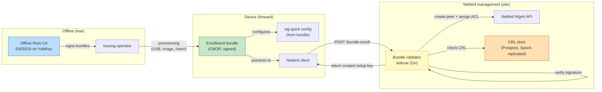

# Offline Enrollment Bundles

A second enrollment path that works when the Netbird management server is unreachable. Devices carry an offline-signed capability that proves their identity and role to the mesh without phoning home for a setup key. Once management is reachable again, the device transitions to a normal Netbird peer record.

> **Scope (2026-04-20):** Nebula-pattern offline-signed identity. Replaces the narrower "Pre-shared WG bootstrap configs" concept — the bundle *contains* a pre-shared WG config plus a signed capability, ACL group assignment, known-peer endpoints, expiry, and revocation nonce. One concept, not two.

**Status:** Design complete. Implementation: Phase 2A — see `docs/project/roadmap.md` and `docs/project/implementation-plan.md` Block 2C.

---

## Table of contents

- [1. Why](#1-why)
- [2. Trust model](#2-trust-model)
- [3. Bundle format](#3-bundle-format)
- [4. Components](#4-components)
- [5. End-to-end flows](#5-end-to-end-flows)
- [6. Revocation](#6-revocation)
- [7. Key ceremony](#7-key-ceremony)
- [8. Failure modes](#8-failure-modes)
- [9. Scope boundaries](#9-scope-boundaries)
- [10. Decision log](#10-decision-log)
- [11. Control-plane endpoint and WG keypair (silent-control-plane integration)](#11-control-plane-endpoint-and-wg-keypair-silent-control-plane-integration)
- [12. Bundle auto-renew (Block 22K.9, design-only, added 2026-05-13)](#12-bundle-auto-renew-block-22k9-design-only-added-2026-05-13)

---

## 1. Why

Current enrollment assumes the Netbird management server is reachable from the device at enrollment time. Every PACE path — Primary (VPS relay), Alternate (direct relay IP), even the listed Contingency (pre-shared WG to a known peer) — eventually terminates at the management server. If no path to management exists, no new peer can join.

In a denied-cloud scenario (AWS regions unreachable, sovereignty dispute, kinetic strike on VPS regions, or a disconnected forward site with no upstream link) we still need to bring a new device online. The existing design assumed an operator at management could issue a setup key on demand; under denial, that operator is unreachable.

Offline bundles close this gap by decoupling *identity issuance* from *management reachability*:

- Identity is minted at provisioning time (rear echelon, air-gapped).
- The device carries the signed identity forward.
- Any reachable Netbird management server (including a local one during Island Mode, Phase 4) validates the signature chain and accepts the peer without a per-enrollment operator action.

This is the Nebula pattern — offline-signed certs, explicit trust chain, no phone-home — adapted to live alongside Netbird's setup-key flow rather than replacing it.

---

## 2. Trust model



**Root of trust:** an Ed25519 signing key held on a YubiKey (PIV slot) at the rear echelon, plus an encrypted backup on a second YubiKey stored separately. Management servers hold only the CA **public** key, distributed by Ansible. No private key material ever lives on a network-reachable host.

**What a bundle authorizes:** creation of exactly one Netbird peer record with a named device identity, assignment to a fixed set of ACL groups, for a fixed window. A bundle is not a session credential — it is a one-shot capability that converts into a normal Netbird peer at first enrollment.

**What a compromised bundle gets an attacker:** the ability to stand up one peer with the ACL scope of that bundle, until the bundle's nonce is added to the CRL. Bundles are scoped to 90 days and to one device_id; the blast radius is bounded by ACL group, not by the whole mesh.

**What a compromised CA key gets an attacker:** the ability to mint arbitrary bundles until the CA is rotated. This is the catastrophic case and is why the CA key lives on a YubiKey, never touches a networked host, and is used only in supervised ceremonies (§7).

---

## 3. Bundle format

CBOR envelope. Compact, deterministic serialization, Ed25519 signature over the canonical encoding of all fields except `signature`.

```
EnrollmentBundle {
  version:             u8,               // format version (1)
  device_id:           tstr,             // "host-site-01"
  peer_pubkey:         bstr,             // WG Curve25519 pubkey (32 bytes)
  acl_groups:          [tstr],           // ["role-a", "role-b"] — for gear-class machines DERIVED from the node-class via --from-machine (D6a, below), never hand-typed
  site:                tstr,             // "site-cp"
  known_endpoints: [                     // bootstrap path list, tried in order
    {
      addr:            tstr,             // IP literal preferred (e.g. "203.0.113.5:51821") — DNS names tolerated for "peer" / "relay" kinds only
      pubkey:          bstr,             // peer's WG pubkey
      kind:            tstr,             // "relay" | "peer" | "mgmt" | "cp-relay" (silent-control-plane WG endpoint per ADR 0313)
      mesh_addr:       tstr              // OPTIONAL (omitempty). Peer's mesh-side address (no CIDR; e.g. "198.18.0.2"). Populated only for kind="cp-relay" — device-side renderer derives AllowedIPs = mesh_addr/32 per peer. Block 22K.
    }
  ],
  cp_device_pubkey:    bstr,             // OPTIONAL (omitempty). Device's wg-cp0 (silent control plane outer WG wrap) Curve25519 pubkey (32 bytes); registered with relays' wg-cp0 allowlists at issuance — see §11.2 + §11.3. Absent → bundle issued without wg-cp0 in scope.
  cp_device_privkey:   bstr,             // OPTIONAL (omitempty). Device's wg-cp0 Curve25519 privkey (32 bytes). Sensitive material — bundle file is mode 0600, shred-after-extract on device — see §11.2 amendment. Always paired with cp_device_pubkey (CheckCPDeviceKeypair invariant). Block 22K.
  cp_device_address:   tstr,             // OPTIONAL (omitempty). Device's wg-cp0 interface address as CIDR (e.g. "198.18.0.6/24"). Device-side renderer writes verbatim to [Interface] Address line. Pairs with cp_device_pubkey. Block 22K.
  enrollment_anchor:   tstr,             // OPTIONAL (omitempty). Portal-registry slot anchor of the machine this bundle was issued from (bundle-create --from-machine, machine-mesh-alignment D6a). Ties the joined peer to its custody edge without a portal round-trip. Absent for hand-grouped (infra/site) bundles and all pre-D6a bundles.
  node_class:          tstr,             // OPTIONAL (omitempty). The machine's born-as node-class (ADR 1116) recorded at issuance; acl_groups is its derivation. Pairs with enrollment_anchor.
  snitch_probe_key:    bstr,             // 32 bytes random; the device's snitch collector API key (SHA-256 of this is registered in the snitch api_keys table at issuance — see §11.6a, Block 61)
  ntp_attestation_pubkey: bstr,          // Ed25519 pubkey (32 bytes) — the peer's ntp-health-agent signing key; trust anchor for NTP attestations (universal-ntp-hygiene.md §4.5, ntp-strategy.md §4.6)
  tls_trust_anchor:    bstr,             // OPTIONAL (omitempty). DER-encoded X.509 root cert of the internal TLS CA (ADR 0407 / internal-tls-ca.md). Peers add to TLS root pool for verifying internal-only HTTPS endpoints (e.g. mgmt-API at https://198.18.0.1:443 behind wg-cp0). Absent → no internal TLS CA trust set (graceful for legacy dev/test bundles that don't use internal TLS).
  issued_at:           tstr,             // RFC 3339
  activation_deadline: tstr,             // RFC 3339 — first enrollment must happen before this (issued_at + 14d)
  expires_at:          tstr,             // RFC 3339 — device peer record lifetime (issued_at + 90d)
  nonce:               bstr,             // 16 random bytes, revocation handle
  ca_id:               tstr,             // "goat-ca-2026-04"
  signature:           bstr              // Ed25519 over CBOR-canonical(fields above)
}
```

**`acl_groups` for gear is derived, never hand-typed** (machine-mesh-alignment D6a). A gear-class machine's bundle is issued *from the portal registry*: `bundle-create --from-machine <anchor>` reads the machine's row (`GET /api/machines/{anchor}`, operator key from `$GOAT_PORTAL_OPERATOR_KEY`) and sets `acl_groups` to the groups derived from its born-as node-class (ADR 1116 §9), stamping `enrollment_anchor` + `node_class` alongside — so a validator or the provenance-guard reconcile can tie the joined peer to its custody edge without a portal round-trip. Hand-typing a gear-class group into `--acl-groups` is refused against `ops/ansible/netbird_acl_taxonomy.yml`; infra/site groups remain hand-supplied — the pre-existing legitimate use. This makes issuance require portal reachability, which is a fair assumption at a connected signing station: the offline part of offline enrollment is the JOIN, not the issuance. Both fields are optional additions under the v1 field-extension policy — pre-D6a bundles parse and verify unchanged.

The `ntp_attestation_pubkey` is generated by the peer's `ntp-health-agent` on first deploy (private half stays on the device; public half is registered into the bundle at issuance time). Because the field is inside the CA signature, a mgmt-host compromise cannot forge the binding between a device_id and its attestation key. Peers enrolled via setup-key (no bundle) have no CA-signed binding and their attestations fall into `unattested-publisher` per [`publisher-trust-model.md`](publisher-trust-model.md).

Wire size: ~400-600 bytes. Delivered to the device as a cloud-init seed file placed at `/etc/goat/enrollment/enrollment.cbor` on first boot (Ubuntu 24.04 on x86, Ubuntu-for-Tegra 22.04 on Jetson-class arm64), or on a USB stick for air-gapped provisioning.

**Why CBOR, not JSON:** deterministic canonical encoding for signing, compact wire size, no ambiguity in whitespace or numeric representation. JSON canonicalization (RFC 8785) is possible but adds a dependency every validator must implement identically.

**Why Ed25519, not ECDSA-P256:** Ed25519 has deterministic signatures (no RNG-dependent nonce), is standard in Go's crypto library and on YubiKey PIV, and is part of the FIPS 186-5 update (approved 2023). No compliance downside.

### 3.1 Activation deadline and delivery tracking — bundle-in-flight theft mitigation

**Threat:** a bundle is stolen between issuance and first use (e.g. during physical transport from the rear echelon to the forward site). The thief's device beats the legitimate device to enrollment, registering with the right `device_id` and ACL groups. From the validator's perspective the enrollment is valid.

**Mitigations, layered — each reduces the attack window, together they shrink it to negligible:**

1. **Activation deadline (`activation_deadline` field, default issued_at + 14 days).** Validator rejects a bundle presented for *first* enrollment after `activation_deadline` even though `expires_at` may still be 76 days out. A stolen bundle that isn't used within the transit window becomes worthless for enrollment. The 90-day `expires_at` remains the horizon for CRL retention so revocations stay valid against any late replay attempts.

2. **Issuance registry with delivery states.** `ops/enrollment/registry.jsonl` is append-only and records each bundle's lifecycle:
   ```
   states: issued → in_transit → delivered → enrolled
                                         ↘ suspected_lost  (operator flag)
   ```
   Operator updates state via `./bundle-state.sh --nonce <nonce> --state delivered --recipient <operator-id>`. State transitions are logged and auditable. Registry does not contain bundle material — only metadata.

3. **Delivery-confirmation deadline.** Operational requirement (in runbook, not enforced by code): operator must mark a bundle `delivered` within 72h of issuance, or the issuing operator receives a reminder. Not receiving confirmation within 7 days triggers a mandatory decision: either confirm delivery (late) or revoke.

4. **Auto-revoke on no-show.** A daily cron on the CA host checks for bundles where `state ∈ {issued, in_transit}` AND `now() > activation_deadline`. Each such bundle is automatically added to the CRL with reason `expired-no-show`. The window where a stolen bundle can still be used is capped at 14 days — significantly less if delivery tracking works as designed.

5. **Active-enrollment monitoring.** Validator logs every enrollment with structured fields (`device_id`, `nonce`, `source_ip`, `timestamp`). If a bundle enrolls from a `source_ip` outside the expected site's IP range, alert fires. Not blocking (a legit device might enroll via an unexpected transport), but a strong signal for operator investigation.

**What this doesn't stop:** a sophisticated attacker who steals the bundle *and* forges delivery confirmation through a compromised operator channel. That's a credential-compromise problem, not a bundle-format problem — mitigate through separation of duties (the issuing operator and the confirming operator should not be the same person at forward sites where that's feasible) and through the `suspected_lost` fast-path that auto-revokes without requiring CA signing ceremony (a pre-authorized revocation key on the issuing operator's workstation covers the common case).

---

## 4. Components

| Component | Path | Language | Purpose |
|---|---|---|---|
| **CA tooling** | `ops/enrollment/ca/` | Go | Init CA, rotate signing key, issue bundle, revoke bundle. YubiKey PIV via `go-piv-client`. |
| **Bundle issuance CLI** | `ops/enrollment/issue-bundle.sh` | Shell wrapper | Operator command over the Go CLI |
| **Device consumer** | `ops/enrollment/device/` | Go + systemd | Cloud-init snippet + oneshot that reads bundle, configures wg-quick, invokes Netbird |
| **Validator sidecar** | `ops/enrollment/validator/` | Go (~500 LOC) | HTTP service on the mgmt host, verifies signature, drives Netbird API |
| **CRL publisher** | `ops/enrollment/crl/` | Go | Writes CRL entries to Postgres (`enrollment_crl` table), served at `https://netbird.legacy.example/enrollment/crl` |
| **Ansible role** | `ops/ansible/roles/enrollment-validator/` | Ansible | Deploys validator sidecar + CA public key |

**Critical design choice — sidecar, not Netbird fork.** The validator runs as a separate process alongside Netbird on the management host. It accepts `POST /bundle-enroll`, verifies the signature, calls the Netbird Management API (`POST /api/peers` + ACL group assignment + scoped one-time setup key), and returns the setup key to the device. Netbird itself is unmodified. We stay on upstream.

**Trade-off accepted:** one more component to operate. Mitigation: validator is ~500 LOC, single binary, systemd unit, Prometheus metrics, same Ansible pipeline as everything else. Compared to maintaining a Netbird fork across Netbird's ~69 commits/year to `sql_store.go`, operating a sidecar is strictly cheaper.

### 4.1 Validator DoS hardening

The validator is a critical-path service that accepts requests over the network and performs cryptographic verification + database writes. Must be hardened against abuse without breaking Island Mode enrollment from constrained forward sites. Layered defenses:

**1. Mesh-only exposure.** Validator endpoint is reachable *only* from within the WireGuard mesh — Traefik `IPAllowList` middleware restricts source IPs to `100.64.0.0/10` (WireGuard CGNAT range), same pattern already used for all hosted services. Not internet-reachable. An attacker must first be an enrolled mesh peer (which is exactly the state this system is trying to gate), or must compromise the relay infrastructure (out-of-scope for this layer).

**2. Per-source rate limit.** Token bucket, 10 enrollment attempts per minute per source mesh-IP. Returns HTTP 429 with `Retry-After` when exceeded. Legitimate enrollment does 1-3 attempts (one per known_endpoint in the bundle until one succeeds); 10/min is ample headroom.

**3. Per-nonce rate limit.** 3 attempts per hour per bundle nonce. Stops an attacker from banging repeatedly on a specific stolen bundle to brute-force any TOCTOU window in the validator. Tracked in a small in-memory LRU (bounded by `max_tracked_nonces = 10000`).

**4. Slow-reject on signature failure.** On Ed25519 verify failure, the validator sleeps 200ms before returning the rejection. Amplifies attacker cost for signature-guessing or CPU-exhaustion attempts. Ed25519 verify itself is <1ms so no meaningful cost to legitimate clients.

**5. Global circuit breaker.** Prometheus counter `enrollment_signature_invalid_total` is monitored; if it grows by >50 events in 5 minutes, validator enters **cooldown mode**: all new enrollment requests return HTTP 503 for 10 minutes. Alerts fire. Cooldown is auto-release — no operator intervention needed — but the pattern will be visible to the incident response path.

**6. Netbird API auth.** Validator authenticates to the Netbird Management API via a service-account token stored in `/etc/enrollment-validator/netbird.token` (0400, root). Token is scoped to peer-create + ACL-assign operations; cannot read other peer data or modify policies. Rotated on a schedule (runbook).

**7. Resource limits.** systemd unit sets `MemoryMax=256M`, `TasksMax=64`, `CPUQuota=25%`. An exhaustion attack that squeaks past rate limits cannot starve the host. Network host has >4GB RAM, so this is a generous ceiling with plenty of headroom to fail visibly before taking the host down.

**8. Observability.** Prometheus metrics emitted by the validator — `enrollment_success_total`, `enrollment_signature_invalid_total`, `enrollment_rate_limited_total`, `enrollment_circuit_breaker_active`, `crl_last_refresh_seconds`. Alert rules in `ops/ansible/roles/enrollment-validator/files/alerts.yml`.

**What this doesn't stop:** a mesh peer that has already been enrolled (and thus has mesh-IP reachability) and wants to probe the validator. Rate limits apply at the source-IP level. If the probing peer is suspected malicious, revoke it via the normal Netbird ACL path — the validator is not the first line of defense against already-enrolled peers.

**Time correctness:** the validator is a publisher under the universal NTP hygiene policy (single local source of truth, cross-site attestation, fails closed if NTP class falls below threshold) because it writes enrollment events with timestamps. Policy lives in `docs/design/universal-ntp-hygiene.md` — landing from a parallel workstream; may not yet be on origin/main when you read this.

---

## 5. End-to-end flows

### 5.1 Provisioning flow (rear echelon, offline)

```
1. Operator plugs YubiKey into air-gapped workstation, enters PIN
2. issue-bundle.sh --device host-site-01 \
                   --site site-cp \
                   --role role-a \
                   --endpoints relay-1,relay-2,site-lan-peer \
                   --out host-site-01.cbor
3. CLI generates WG keypair, builds EnrollmentBundle, signs with YubiKey
4. CLI writes bundle + WG private key to output directory
5. Operator copies bundle + private key to device provisioning image (/oem/)
6. Bundle registered in device registry (ops/enrollment/registry.jsonl)
7. YubiKey removed, locked away
```

Device registry is append-only, committed to the repo. Records `device_id`, `nonce`, `expires_at`, `issued_by`. Never stores private material. Used to answer "who did we ever issue for?" and to drive revocation.

### 5.2 Enrollment flow (forward, management reachable)

```
1. Device boots with bundle in /oem/enrollment.cbor
2. systemd oneshot:
   a. Reads bundle, validates expiry locally
   b. Configures wg-quick with peer_pubkey + first known_endpoint
   c. Establishes raw WireGuard tunnel
   d. Attempts HTTPS POST to https://netbird.legacy.example/enrollment/validate
3. Validator sidecar:
   a. Verifies Ed25519 signature against CA public key
   b. Checks nonce not in CRL
   c. Checks device_id not already enrolled (idempotency)
   d. Calls Netbird Mgmt API:
      - create peer with peer_pubkey, name=device_id
      - assign to ACL groups named in bundle
      - generate one-time setup key scoped to this peer
   e. Returns setup key to device
4. Device runs: netbird up --setup-key <returned_key> --management-url ...
5. Standard Netbird enrollment proceeds
6. Raw WG tunnel from step 2c torn down (Netbird manages wt0 from here)
```

No human in the loop. Time to enrollment: ~30 seconds assuming endpoint is reachable.

### 5.3 Enrollment flow (forward, management unreachable — Island Mode)

```
1-2. Same as 5.2, but step 2d fails — no route to netbird.legacy.example
3. Device falls back through known_endpoints in order
4. If any endpoint is a local management server (kind: "mgmt"), device reaches
   that endpoint's validator sidecar and enrolls there
5. Local management server records the peer in its local Postgres
6. When WAN returns, Spock replicates the peer record to other sites (normal HA flow)
```

This path depends on Phase 4 (local management) being stood up at the disconnected site. Without a local management server the device cannot enroll — the bundle is necessary but not sufficient. Island Mode completeness is tracked in the Phase 4 work.

### 5.4 Revocation flow

```
1. Operator: revoke-bundle.sh --device host-site-01 --reason compromised
2. CLI emits signed CRL delta to ops/enrollment/crl/pending/
3. Operator pushes CRL delta to any reachable management server
4. Management server appends to enrollment_crl table
5. Spock replicates to all sites
6. All validator sidecars refresh CRL on 60s interval
7. Any pending or future enrollment attempt with that nonce is rejected
8. If peer already enrolled: operator runs netbird-revoke on the peer record
   (separate action — bundle revocation does not cascade to active peers)
```

Bundle revocation and peer revocation are separate concerns by design. A revoked bundle stops new enrollments; a revoked peer stops an active one. Conflating them hides which action was taken.

---

## 6. Revocation

CRL is a signed, append-only list of revoked bundle nonces. Structure:

```
CRLEntry {
  nonce:       bstr,    // bundle nonce being revoked
  ca_id:       tstr,    // which CA issued the bundle
  revoked_at:  tstr,    // RFC 3339
  reason:      tstr,    // "compromised" | "decommissioned" | "reissued" | "expired-no-show"
  signature:   bstr     // CA signature over canonical fields
}
```

### 6.1 Two-phase distribution

Block 2C (Phase 2A) lands before the multi-site Spock HA infrastructure is production-deployed (that's Phase 4 per `ha-multi-site.md`). To avoid blocking Block 2C on Spock readiness, CRL distribution runs in two phases:

**Phase 2A — single-source HTTP pull (Block 2C ships with this):**

- One management host is the **CRL issuance endpoint**. CA tooling publishes signed CRL deltas to its local Postgres `enrollment_crl` table.
- Issuance endpoint exposes `GET /enrollment/crl` (mesh-only via Traefik) returning the signed CRL in canonical CBOR form.
- Validator sidecars on other management hosts poll the issuance endpoint every 60s and cache the CRL locally (Postgres table on each site, populated by pull-replication, not Spock).
- All signature verification is local — validators never trust another validator, only the CA signature over the CRL entries.

**Phase 3 (or whenever Spock multi-master stabilizes) — migrate to Spock-replicated CRL:**

- Data structure stays identical (`enrollment_crl` table unchanged).
- Replace HTTP pull with Spock logical replication — any management host accepts CRL writes; Spock replicates to all sites.
- Migration is a one-time switchover: stop HTTP pull, add Spock subscription, verify CRL converges across sites.
- No validator code change beyond the source of data (local Postgres table is already the read path).

**Why this works:** Signed CRL entries are self-authenticating — the replication mechanism does not carry trust. Whether replicated by Spock or HTTP pull, the validator only trusts what it can verify against the CA public key. The distribution path is operational convenience, not security boundary.

### 6.2 Refresh behavior

Validator sidecar polls its local CRL source (HTTP in Phase 2A, Postgres in Phase 3) every 60s. Stale-but-usable window: 24 hours. If CRL has not updated in 24 hours, validator continues to accept enrollments using the last-known CRL but logs a warning to Prometheus and journald. After 72 hours without refresh, validator fails closed — rejects all bundle enrollments.

**Why fail-open-for-a-while, then fail-closed:** a disconnected site needs to enroll replacement peers locally; fail-closed-immediately would defeat Island Mode. A 24-hour stale window is a reasonable compromise between denial-of-service resistance and revocation responsiveness.

**Why not cryptographically-fresh CRL (OCSP-style):** OCSP requires the CA to be online for every validation request. Incompatible with the air-gapped CA custody model. Offline-signed CRL with staleness windows is the right trade-off for this threat model.

---

## 7. Key ceremony

### 7.1 CA custody

Single active signing YubiKey (PIV slot 9c). Encrypted backup YubiKey with the same key material, stored separately (different location, different operator). Recovery from backup is manual and logged.

**Why not 2-of-3 Shamir split:** operational simplicity outweighs the marginal security benefit at current scale. Two YubiKeys + one trusted operator is tractable; three-of-N split requires coordinating multiple operators for every signing ceremony. Revisit if scale or threat model changes.

### 7.2 Initial ceremony (one-time)

Performed on an air-gapped workstation. **Operator runbook for the production-backend ceremony (Block 22M, 2026-05-06):** [`docs/operations/yubikey-piv-ca-ceremony.md`](../operations/yubikey-piv-ca-ceremony.md) — 10 sections covering when-to-run, pre-flight, primary + backup YubiKey ceremonies, distribution, re-issue, retire-dev-root, test rehearsal, rotation, lost-YubiKey recovery. Summary of mechanics:

```
1. Boot air-gapped workstation from trusted USB (or use the goat laptop air-gapped)
2. Insert YubiKey A; verify firmware ≥ 5.7.0 via `ykman info`
3. Run: ca-init --mode prod --id goat-ca-<date> [--gen-root-cert <path>]
   This generates an Ed25519 keypair INSIDE YubiKey A's PIV slot 9c (touch
   policy: always; pin policy: once); private key never exposed to host.
4. CLI emits the public-key PEM to stdout — operator saves to
   ops/enrollment/public-keys/prod-goat-ca-<date>.pem
5. Repeat steps 2-4 against YubiKey B with a DIFFERENT --id. (PIV-stored
   private keys cannot be exported, so "backup" here means a redundant
   independent signing root, not a copy of the same key. Both pubkeys
   are committed; mgmt hosts trust both CA-IDs simultaneously.)
6. Commit public-keys/*.pem + root-cert-*.pem
7. Hand YubiKey A to primary custodian, YubiKey B to backup custodian
8. Ansible distributes public-keys/*.pem to all management servers
```

The clone-key-material-to-YubiKey-B step from the pre-Block-22M draft is **rejected** — PIV slot privkeys are non-exportable by design (that's the security property). Backup discipline is "two independent roots with a third-party operator each holding one," not "two YubiKeys with the same key."

### 7.3 Rotation (annual or on compromise)

New CA key minted; both CA public keys (old + new) distributed to management servers with a rollover window. New bundles are signed with the new key; old bundles remain valid until expiry. After the rollover window, old public key removed.

### 7.4 Compromise response

If the primary YubiKey is lost or suspected compromised:

1. Immediate: revoke all outstanding bundles via CRL (scripted bulk revocation from the registry)
2. Within 24h: perform ceremony 7.2 with a new key on a new YubiKey pair
3. Within 72h: re-issue bundles for all active devices with the new CA
4. Update `ops/enrollment/public-keys/` with new CA public key + deprecation date for old

Reissuance is idempotent — same device_id, new nonce, new signature. Device records on management servers are not affected (new bundle enrollments hit the same device_id and are treated as the already-enrolled case via idempotency check in §5.2 step 3c).

---

## 8. Failure modes

| Mode | Detection | Behavior |
|---|---|---|
| Expired bundle (peer record horizon) | Validator checks `expires_at` | Rejected with `expired_at` in response; operator re-issues |
| Activation deadline passed | Validator checks `activation_deadline` before first-enrollment check | Rejected with `activation_deadline_exceeded`; bundle was not used within 14 days |
| Revoked bundle (nonce in CRL) | Validator CRL lookup | Rejected with `revoked` in response |
| Bundle signature invalid | Ed25519 verify fails | Rejected with `invalid_signature` after 200ms slow-reject; contributes to circuit-breaker counter |
| Unknown CA | `ca_id` not in validator's public-keys dir | Rejected with `unknown_ca`; alert — possible misprovisioned device |
| Device already enrolled with different pubkey | Idempotency check | Rejected with `device_rebind_forbidden`; requires operator to revoke old peer first |
| Rate-limit exceeded (per source IP) | Token bucket | HTTP 429 with `Retry-After` |
| Rate-limit exceeded (per nonce) | Per-nonce LRU | HTTP 429; 3/hour ceiling |
| Circuit breaker active | Counter threshold tripped | HTTP 503 for 10 minutes; auto-release |
| CRL refresh failing | Prometheus gauge `crl_last_refresh_seconds` | Warn at 24h, fail-closed at 72h |
| CA YubiKey lost | Manual / out-of-band | Compromise response §7.4 |
| Validator sidecar down | Netbird management keeps serving; setup-key enrollment still works | Bundles queue on device; device retries every 30s |
| Auto-revoke no-show | Daily cron on CA host | Bundles past activation_deadline without enrollment get CRL entries with reason `expired-no-show` |
| NTP class below threshold | Universal NTP hygiene check | Validator refuses to issue enrollment timestamps — fails closed per the universal NTP hygiene policy (see `docs/design/universal-ntp-hygiene.md` when present on main) |

---

## 9. Scope boundaries

**In scope (Phase 2A):**
- CA tooling + YubiKey integration (with file-based dev CA fallback — see §9.1)
- Bundle format + issuance CLI
- Validator sidecar
- CRL pipeline (Phase 2A: single-source HTTP pull; migrate to Spock in Phase 3 per §6.1)
- Cloud-init / systemd integration on **x86 and arm64 hosts**
- Runbook for key ceremony and revocation drill

**Out of scope (Phase 2A):**
- **Island Mode local management server.** Bundles are necessary but not sufficient for offline site enrollment — a local management server is the other half. Tracked in Phase 4.
- **Automated bundle issuance from a provisioning pipeline.** Phase 2A keeps issuance an explicit operator action. Automation can follow once the ceremony is routine.
- **Coalition / multi-tenant CAs.** One CA for the current mesh. Multi-CA trust is a Phase 3+ question.

### 9.1 YubiKey hardware fallback (dev-only)

YubiKey 5.7.0+ firmware is required for Ed25519 PIV. To test the design end-to-end without the hardware, the dev fallback keeps everything identical except where the CA private key lives:

**Dev mode (file-based CA, pre-YubiKey):**
- CA Ed25519 keypair generated on the air-gapped workstation with `ssh-keygen -t ed25519` equivalent and stored in an age-encrypted file held by the operators.
- `issue-bundle.sh --mode dev` reads the age-encrypted key, decrypts in memory, signs, wipes. No touch policy, no PIN — just age passphrase.
- Bundle format is identical. Validator cannot distinguish dev-signed from YubiKey-signed bundles (it only verifies against the CA public key).
- `ca_id` carries a `dev-` prefix (`dev-goat-ca-2026-04`) to make provenance visible in audit logs.
- Generated public key goes into `ops/enrollment/public-keys/` under the `dev-` name. Ansible distributes it to management hosts alongside (not in place of) the future production key.

**Promotion to YubiKey (once hardware lands):**
1. Perform the production ceremony in §7 on the air-gapped workstation with the new YubiKey.
2. Generate fresh CA with production `ca_id` (no `dev-` prefix).
3. Distribute new public key via Ansible.
4. Mark dev CA as **deprecated** — remove the dev public key from `ops/enrollment/public-keys/` after a 7-day overlap.
5. Re-issue all outstanding bundles with the production CA. The dev-signed bundles become unusable once the dev public key is removed.
6. Destroy the age-encrypted dev CA key and record its rotation.

**Why this works:** the validator's trust decision is "verify signature against any known CA public key in `public-keys/`." Dev CA and production CA are indistinguishable at the protocol level — only the operator's key custody differs. This is the same pattern used for staging environments in most PKI deployments.

**What this does not do:** dev mode is **not** safe to ship to the forward pilot. The age-encrypted file is weaker than a hardware token — anyone with the age recipient key and the file can mint bundles. Fine for end-to-end testing and staging. Not fine for any production site. The runbook marks this explicitly.

**Gate to switch off dev mode:** YubiKey hardware received + firmware 5.7.0+ verified + production ceremony dry-run completed + production CA public key distributed. At that point, any PR adding a new `--mode dev` call fails CI.

---

## 10. Decision log

| Decision | Date | Rationale | Revisit if... |
|---|---|---|---|
| Sidecar validator instead of Netbird fork | 2026-04-20 | Keeps us on upstream Netbird. Validator is ~500 LOC vs maintaining a fork against a 5,700-LOC file with 69 commits/year. | Netbird upstream adds native signed-enrollment support |
| Ed25519 over ECDSA-P256 | 2026-04-20 | Deterministic signatures, YubiKey PIV support, FIPS 186-5 approved. | NIST deprecates Ed25519 (unlikely) |
| CBOR over JSON for bundle format | 2026-04-20 | Deterministic canonical encoding without RFC 8785 implementation burden, compact size. | Validator/issuance implementations diverge on canonicalization |
| Single YubiKey + encrypted backup, not Shamir split | 2026-04-20 | Operational simplicity at current scale; two-YubiKey recovery is tractable. | Scale grows past ~3 issuing operators or threat model shifts |
| 90-day bundle expiry | 2026-04-20 | Tactical context — devices that haven't enrolled in 90 days are probably dead or compromised. Rotation is cheap. | Rotation becomes operationally painful |
| Scope: x86 + arm64 | 2026-04-20 (corrected) | Toolchain is architecture-agnostic; the test matrix covers both architectures. | New hardware target added |
| CRL fail-open for 24h, then fail-closed at 72h | 2026-04-20 | Island Mode requires local enrollment; hard fail-closed defeats it. Stale-but-usable window is bounded. | Operational data shows the 24h window creates real risk |
| Replace "Pre-shared WG bootstrap" with signed bundles | 2026-04-20 | Bundle format contains pre-shared WG config as one field; signed envelope is strictly richer. No reason to maintain both concepts. | Bundle validation overhead proves impractical for the offline case (unlikely — validation is local Ed25519) |
| Two-phase CRL distribution: HTTP pull (Phase 2A) → Spock (Phase 3) | 2026-04-20 | Spock multi-master isn't production-deployed until Phase 4 per `ha-multi-site.md`. Blocking Block 2C on Spock readiness delays offline enrollment by months. Signed CRL entries are self-authenticating, so the replication mechanism is operational convenience rather than a trust boundary. | HTTP pull operational burden exceeds estimate OR Spock multi-master lands ahead of schedule |
| 14-day activation deadline separate from 90-day bundle expiry | 2026-04-20 | Bundle-in-flight theft risk. A stolen bundle should be useless within the transit window even though the device peer record horizon may need to be longer. Two independent fields let us tune them separately: activation deadline controls first-enrollment window, expires_at controls CRL retention horizon. | Operational data shows 14 days is too tight (re-issue burden) or too loose (successful theft within window) |
| Issuance registry + delivery state tracking + auto-revoke on no-show | 2026-04-20 | Layered defense on top of the activation deadline. Registry is cheap (JSONL file in the repo), state tracking is an operator discipline, auto-revoke is a one-line cron. Together they cap the theft window much tighter than activation deadline alone. | Operator overhead proves unsustainable (revisit state-tracking UI or drop to simpler operator-confirm-only policy) |
| Mesh-only validator exposure + layered DoS hardening | 2026-04-20 | Validator is critical-path. Layered defenses (mesh-only, per-IP rate limit, per-nonce rate limit, slow-reject on signature failure, circuit breaker, resource limits) cap blast radius without breaking Island Mode enrollment. | Attack pattern emerges that these layers don't cover (specific CVE-class attack on Ed25519 verify, etc.) |
| Validator authenticates to Netbird API via scoped service-account token | 2026-04-20 | Token scoped to peer-create + ACL-assign only; cannot read other peer data or modify policies. Minimizes blast radius if validator is compromised. Rotation via runbook. | Netbird introduces finer-grained service-account scoping (use it); or validator compromise shown to escape token scope |
| `ntp_attestation_pubkey` field added to bundle schema as trust anchor for NTP attestations | 2026-04-21 | Alternatives considered: (a) Netbird peer label as registry — rejected because peer labels are mutable metadata via the management API, so a mgmt-host compromise could rewrite the binding; (b) TOFU on first attestation — rejected because first contact could be adversarial, which is exactly the case the attestation is meant to prevent; (c) derive from WG private key — rejected because the public half of a derived key isn't retrievable from the WG public key, so a registry step is still required. The bundle field is inside the CA signature, which cannot be forged by a mgmt-host compromise. Zero-cost extension — bundle format is still being designed. | Operator-issued setup keys become the dominant enrollment path AND cross-site attestation trust is required for those peers (then a separate registry mechanism would need to be designed) |
| `cp_device_pubkey` field + `cp-relay` endpoint kind added; bundles become the only credentialed control-plane discovery path | 2026-04-26 | ADR 0313 silences the relay's mgmt-API listener behind an outer WireGuard tunnel (`wg-cp0`); ADR 0314 retires public DNS for the control plane. Both decisions push endpoint discovery + per-device credential into the bundle, which is the only artefact that already crosses the rear-echelon → forward-site boundary under hardware-rooted custody. Alternatives considered: (a) shared control-plane WG key across all devices — rejected, defeats per-device revocation; (b) device generates CP keypair and registers via setup-key flow on first contact — rejected, reintroduces the public listener we are trying to remove; (c) control-plane WG key derived from data-plane WG key — rejected, conflates two trust domains and complicates rotation. | Detection-evasion work lands and changes the public-edge story; or a high-volume third-party-device enrollment use case appears that bundles cannot serve |

---

## References

- `docs/design/security-architecture.md` — overall trust model
- `docs/design/ha-multi-site.md` — Spock replication used for CRL distribution
- `docs/project/roadmap.md` — Phase 2A placement
- `docs/project/implementation-plan.md` — Block 2C work breakdown
- [`docs/operations/enrollment-bundle-runbook.md`](../operations/enrollment-bundle-runbook.md) — key ceremony + revocation drill
- Nebula certificate model reference: https://github.com/slackhq/nebula — prior art for offline-signed mesh identity
- YubiKey PIV Ed25519 support: Firmware 5.7.0+ (released 2024)

---

## 11. Control-plane endpoint and WG keypair (silent-control-plane integration)

Added 2026-04-26 to track the offline-enrollment work needed for the silent-control-plane shift. Two ADRs land together in the same change set:

- [ADR 0313 — Silent control plane via outer WireGuard wrap](../adr/0313-silent-control-plane-outer-wg-wrap.md)
- [ADR 0314 — No public DNS for the control plane](../adr/0314-no-public-dns-for-control-plane.md)

This section is the design-doc half of those decisions: what changes in the bundle, what changes at the relay, and how the device first reaches the management plane once the public listener is gone.

### 11.1 Why this lives in the bundle

Two artefacts have to travel together for a credentialed device to reach the silent control plane: an **endpoint** (relay public IP + UDP port for `wg-cp0`) and a **credential** (the relay's `wg-cp0` public key plus the device's own `wg-cp0` keypair, registered on the relay's allowlist). The bundle is already the only artefact that crosses the rear-echelon → forward-site boundary under hardware-rooted custody. Bolting a second distribution channel on for the control-plane endpoint would defeat the property we are trying to establish.

### 11.2 Bundle schema additions

Six bundle-format extensions land with this design (see §3 for the merged schema):

1. **New endpoint kind `cp-relay`** in `known_endpoints[*].kind`. Carries the relay's `wg-cp0` UDP socket address (IP literal, e.g. `203.0.113.5:51821`) and the relay's `wg-cp0` public key (32-byte Curve25519). One `cp-relay` entry per relay the device should be able to reach for control-plane traffic.
2. **New `mesh_addr` field on `known_endpoints[*]`** (string, optional / `omitempty`, **Block 22K**). The peer's `wg-cp0` mesh-side address (no CIDR; e.g. `"198.18.0.2"`). Populated only for `kind="cp-relay"` entries — when `allowed_ips` (below) is empty, the device-side renderer derives `AllowedIPs = mesh_addr/32` per peer. Absent for legacy kinds (`relay`/`peer`/`mgmt`) where the addressing model is different.
3. **New top-level field `cp_device_pubkey`** (32 bytes, optional / `omitempty`). The device's own `wg-cp0` public key, generated at bundle-issuance time on the air-gapped workstation. Inside the CA signature so the binding between `device_id` + `cp_device_pubkey` is offline-CA-attested. Relays' `wg-cp0` allowlists are populated from this field per §11.3.
4. **New top-level field `cp_device_privkey`** (32 bytes, optional / `omitempty`, **Block 22K amendment 2026-05-05**). The device's own `wg-cp0` private key, generated alongside `cp_device_pubkey` on the air-gapped workstation. Inside the CA signature so the (pubkey, privkey) pair is integrity-bound. Sensitive material — the bundle file is mode 0600 in transit + at rest, and the device-side bundle-apply tool shreds the bundle after extracting the privkey to `/etc/wireguard/wg-cp0-priv.key` (mode 0600). Same secrecy posture as `snitch_probe_key`. Validators reject bundles where exactly one of `{cp_device_pubkey, cp_device_privkey}` is present (CheckCPDeviceKeypair invariant).
5. **New top-level field `cp_device_address`** (string, optional / `omitempty`, **Block 22K**). The device's own `wg-cp0` interface address as a CIDR string (e.g. `"198.18.0.6/24"`). The device-side renderer writes this verbatim into the `[Interface] Address` line of `wg-cp0.conf`. Carrying the CIDR (rather than separate IP + subnet) keeps the bundle self-contained — no out-of-band subnet assumption on the device side. Pairs with `cp_device_pubkey`; absent when `cp_device_pubkey` is absent.
6. **New `allowed_ips` field on `known_endpoints[*]`** (array of CIDR strings, optional / `omitempty`, **Block 22K.7 amendment 2026-05-06**). When non-empty, OVERRIDES the default `mesh_addr/32` derivation in the device-side renderer for that endpoint's `[Peer]` block. Issuance-side: `bundle-create --first-relay-route-subnet=<CIDR>` populates the FIRST relay endpoint with `[mesh_addr/32, <CIDR>]`. Use case: route the wg-cp0 control-plane subnet (e.g. `198.18.0.0/24`) through the first relay so client-to-client traffic transits via Linux IP forwarding on the relay (`net.ipv4.ip_forward=1` is set on the wg-cp0-server role). Without this override, every client only has /32 routes to each relay and outbound packets to other clients drop silently at the WG layer because no peer's AllowedIPs match. Per ADR 0316's "peers pick the lowest-latency reachable" intent — the mixed-fleet design assumes peer-to-peer through relays; this field is what makes it work fleet-wide. Issuer canonicalizes via `net.ParseCIDR` before serialization so issuer + validator agree byte-for-byte.

DNS names remain tolerated for `relay` / `peer` kinds (legacy bridge-side use). The `mgmt` kind is retired in favour of `cp-relay` once ADR 0313 lands; transition handled via bundle reissue at the next 90-day rotation.

**Why privkey rides the bundle (Block 22K amendment 2026-05-05).** The single-distribution-channel property is load-bearing — bolting on a sibling-file delivery (`bundle.privkey` separate from `bundle.cbor`) defeats the rear-echelon → forward-site custody invariant the bundle is designed around. CBOR signing protects integrity, not secrecy; secrecy comes from the same operational discipline that protects `snitch_probe_key` (mode 0600 throughout, shred after extract). The alternative — generating the wg-cp0 keypair on the device + collecting the pubkey before bundle issuance — was rejected because it requires a pre-issuance round-trip from the device to the issuing operator, defeating "one ceremony, one delivery package."

### 11.3 Relay-side allowlist sync

The relay needs each device's `cp_device_pubkey` registered in `wg-cp0`'s allowlist before that device can complete a handshake. Distribution mirrors the CRL design (§6.1):

- **Phase 2A — single-source HTTP pull.** Bundle-issuance CLI writes the new `cp_device_pubkey` + `device_id` to a signed allowlist delta in the same registry update that records the bundle issuance. Relays poll the issuance endpoint every 60s for allowlist deltas; new entries are loaded into `wg-cp0`'s `peer` list via `wg syncconf` (no daemon restart).
- **Phase 3 — Spock-replicated.** Allowlist table moves into the same Postgres + Spock replication path as the CRL.

Revocation reuses the CRL pipeline: a bundle revocation event also removes the corresponding `cp_device_pubkey` from every relay's `wg-cp0` allowlist on the next refresh cycle.

### 11.4 First-contact flow under silent control plane

Replaces §5.2 step 2c-2d for bundle-enrolled devices once ADR 0313 ships:

```text
1. Device boots with bundle in /etc/goat/enrollment/enrollment.cbor
2. systemd oneshot:
   a. Reads bundle, validates expiry + activation_deadline locally
   b. Generates wg-cp0 interface using cp_device_pubkey's private half
   c. For each cp-relay endpoint in known_endpoints (in order):
      i.  Adds the relay as a wg-cp0 peer
      ii. Sends a WG handshake; if no response within 5s, try next cp-relay
   d. Once handshake succeeds, route mgmt-API traffic through wg-cp0
3. Device POSTs to validator sidecar over wg-cp0
4. Validator response (setup key + ACL groups) returned over the same wg-cp0 tunnel
5. Device runs `netbird up --setup-key … --management-url <wg-cp0-private-IP>`
6. Standard Netbird enrollment proceeds; data-plane WG comes up alongside
7. wg-cp0 is left up — it is the long-lived control-plane path, not a one-shot
```

`wg-cp0` is *not* torn down after enrollment. It is the ongoing path for management-plane traffic (peer updates, ACL refreshes, key rotations). Tearing it down each time would re-introduce the chicken-and-egg problem on every reconnect.

### 11.5 Failure modes added

| Mode | Detection | Behavior |
|---|---|---|
| All `cp-relay` endpoints unreachable | systemd oneshot exhausts the list | Device retries with exponential backoff (5s → 5min cap) and logs to journald; falls back to bundle-only Island-Mode behavior if a local management server is present (Phase 4) |
| Relay's `wg-cp0` public key rotated, bundle stale | Handshake fails on every `cp-relay` entry | Operator action: reissue bundles for affected device classes (existing reissue runbook). 90-day expiry caps the worst-case window |
| Allowlist sync lag (Phase 2A HTTP pull) | Device handshake fails 0–60s after issuance | Device retry succeeds once relays poll. Short window; acceptable because new-device first-contact is rarely time-critical |
| Break-glass without bundle | Operator-driven (Block 17A.5 policy-engine approval) | Temporary public A record + plaintext rathole listener republished for ≤24h; auto-revoked; audited |

### 11.6 Phasing

- **Phase 2A scope.** Bundle schema extension, `wg-cp0` listener on each relay, allowlist HTTP-pull sync, device-side first-contact flow, break-glass runbook, dual-stack overlap (silent + legacy public listener) for the cutover window.
- **Phase 2B cutover.** Public DNS retired (ADR 0314), legacy plaintext rathole listener bound to `127.0.0.1` only.
- **Phase 3.** Allowlist sync moved to Spock replication alongside CRL.
- **Detection-evasion work** (AmneziaWG, SPA in front of `wg-cp0`, decoy A records, relay IP rotation) is deferred — see `../project/roadmap.md` priority risk call-out 12 for the explicit checkpoint.

### 11.6a Snitch probe credential extension (Block 61, added 2026-05-04)

Block 61 (snitch v2 — relay-transport visibility) adds one further bundle-format extension:

3. **New top-level field `snitch_probe_key`** (32 bytes, random, generated at bundle-issuance time on the air-gapped workstation alongside the WG keypairs). Inside the CA signature. Optional — bundles for devices that don't run snitch (e.g. relays themselves) omit the field entirely; old validators see it as absent without error.

The probe key gives the device its own authenticated channel to the snitch collector without a post-enrolment HTTP call. Without this extension, the operator path was `curl -fsSL <collector>/install | bash` — a separate trust path that bypassed the offline-CA chain. With it, every bundle-enrolled device boots with its own probe credential already in custody.

#### MVP — operator-side registration (Block 61G, initial 2026-05-06; closure 2026-05-07)

The bundle-issuance CLI generates the probe key locally and registers it with the snitch collector at issuance time. The `/api/keys` admin endpoint is extended (`auth.CreateKeyWithPlaintext`) to accept a caller-supplied `plaintext_key` field, idempotent on label so re-issuance for the same `device-id` replaces the prior key in one transaction.

1. Operator runs `bundle-create --device-id <id> --snitch=true --snitch-collector <url> ...`
2. Issuer computes WG keys, picks endpoints, **generates 32 random bytes locally** as the probe key.
3. Issuer makes a one-time online call to the snitch collector BEFORE writing the bundle to disk:
   ```
   POST /api/keys
   Authorization: Bearer $SNITCH_ADMIN_KEY
   { "role": "probe", "label": "<device-id>", "plaintext_key": "snitch_<hex-of-the-32-bytes>" }
   ```
   The collector hashes the plaintext, deletes any prior row for this label, inserts the new hash. Returns `{registered: true}`.
4. Issuer embeds the **raw 32 bytes** as `SnitchProbeKey` in the bundle's CBOR struct.
5. CA signs the bundle (now including the probe-key field per the canonical encoding).
6. Issuer writes the signed bundle to disk + ships to the device.

If the registration POST in step 3 fails, the bundle file is NOT written — the operator can re-run with the same args for a clean retry. The offline-CA-rooted material flow stays intact: bundle-create is the source of truth for the random bytes, the collector is told about the resulting hash.

On the device:

- Systemd oneshot at first boot reads the bundle.
- The [`snitch-bundle`](../../ops/ansible/roles/snitch-bundle/) ansible role calls [`bundle-extract --field snitch_probe_key --hex <bundle.cbor>`](../../ops/enrollment/cmd/bundle-extract/) to read the 32 bytes as 64 hex chars.
- Role writes `SNITCH_PROBE_KEY=snitch_<hex>` to a mode-0600 env file consumed by the snitch-probe systemd unit. The `snitch_` prefix is prepended at the env template ([`snitch-probe.env.j2`](../../ops/ansible/roles/snitch-bundle/templates/snitch-probe.env.j2)) so the bundle stays agnostic to the on-the-wire form and the collector hashes the same `snitch_<hex>` string at registration + on every probe report.
- Probe authenticates to the collector using the per-device key; collector's `api_keys` row matches by hash.

This MVP keeps the operator-side ceremony online (the issuer must reach the collector at issuance time) but eliminates online-on-the-device — devices remain capable of first boot in fully-island-mode environments because their key is already in custody. Manual registration (no `--snitch-collector` flag) is the documented fallback for air-gapped issuance windows; operator runs the equivalent `curl POST` against the collector after re-establishing reachability.

#### Phase 3+ — collector-pulled deltas (deferred)

When the bundle-issuance pipeline grows beyond a single issuer (multi-site issuance, automation), the simple `POST /api/keys` at issuance won't scale: each issuer would need an admin key, and orphaned keys would accumulate when issuance fails between key-mint and bundle-handover. The Phase-3 pattern moves to a deltas-table approach:

- Bundle-issuance writes `(device_id, snitch_probe_key_hash, role=probe, issued_at)` to a Postgres delta table replicated via Spock alongside the CRL and the cp_device_pubkey allowlist.
- Each snitch collector subscribes via Spock and registers new keys in its `api_keys` table without an admin-API round trip per device.
- Revocation reuses the CRL pipeline: bundle-revocation events also mark the corresponding probe-key row as revoked.

Phase 3 is gated on the broader Phase-3 mgmt-plane work. The MVP at Block 61 is sufficient for the floor 600-peer envelope.

This is the load-bearing reason the snitch probe binary delivery rides the bootstrap bundle (binary, signed, age-encrypted, operator-distributed) and the snitch probe credential delivery rides the offline-enrollment bundle (per-device, CBOR, CA-signed). Two artefacts; one trust chain — same shape as the wg-cp0 endpoint + cp_device_pubkey pair.

#### Schema-vs-code drift note

§3 of this document lists the full field set. Implementation status as of Block 22K land 2026-05-05:

- ✅ Implemented in [`ops/enrollment/bundle/bundle.go`](../../ops/enrollment/bundle/bundle.go): all v1 fields, `tls_trust_anchor` (Block 22J), `snitch_probe_key` (Block 61), `cp_device_pubkey` + `cp_device_privkey` (Block 22K), `known_endpoints[*].allowed_ips` override (Block 22K.7).
- ⏳ Not yet implemented: `ntp_attestation_pubkey` — owned by the NTP track, lands when that track ships its wire-format work.

The CBOR encoding is forward-compatible so old validators reading new bundles silently ignore unknown fields; old bundles parsed by new validators see optional fields as zero-valued.

### 11.7 What this does not do

- Does not hide the *existence* of a UDP port on the relay from a sophisticated WireGuard-fingerprint scanner. Mitigated by bundle-bounded credential distribution; further hidden by deferred detection-evasion work.
- Does not protect the bundle pipeline itself — bundle-in-flight theft mitigations in §3.1 remain the compensating control.
- Does not change the data-plane mesh. Peer-to-peer WireGuard between mesh peers is unaffected; this is purely about the mgmt-plane on-ramp.

---

## 12. Bundle auto-renew (Block 22K.9, design-only, added 2026-05-13)

Bundle TTL is 90 days by design (§10 decision-log). At today's fleet shape, per-bundle issuance is operator-fired via the [production-CA YubiKey-PIV ceremony](../operations/yubikey-piv-ca-ceremony.md). At the Phase-3 floor-600 fleet envelope (ADR 0215), 90-day TTL + manual issuance produces ~7 operator ceremonies per day at steady state — short-TTL bundles *become* the dominant operator-friction source rather than relieving it. Bundle auto-renew closes that gap by automating the per-peer renewal ceremony while preserving the offline-CA invariant.

### 12.1 Goal

Renewal happens without operator keyboard time on healthy peers. Compromised-peer revocation continues through the CRL pipeline (§6) unchanged. Initial issuance for new peers stays operator-fired by design — the initial ceremony is the trust anchor for the device's identity.

### 12.2 Renewal protocol

```text
1. Peer-side bundle-renew daemon (systemd timer) fires ~7d before expires_at
2. Daemon reads current bundle from /etc/goat/enrollment/enrollment.cbor
3. Daemon authenticates to mgmt-host's POST /api/bundle/renew via:
   (a) wg-cp0 tunnel (already authenticated by cp_device_pubkey)
   (b) plus the current bundle's CA-signed device_id presented in the request body
4. Mgmt-host validates current bundle (signature, not expired, not in CRL)
5. Mgmt-host forwards renewal request to the configured signing host (§12.3)
6. Signing host calls bundle-create with same device_id, same cp_device_pubkey
   (default), refreshed nonce + refreshed issued_at + refreshed expires_at +
   refreshed activation_deadline; signs via the current CA backend
7. Renewed bundle returned to peer over the same wg-cp0 tunnel
8. Peer validates renewed bundle against the offline-CA trust root
   (already in custody from the previous bundle's tls_trust_anchor field
   and/or the rollover-window second-root entry per §7.3)
9. Peer atomically replaces /etc/goat/enrollment/enrollment.cbor
   via mktemp + rename (mode 0600 preserved)
10. Peer emits OTLP span + Prometheus counter increment + JSONL state row
```

The renewal endpoint is idempotent on `device_id`: a peer that re-requests within the renewal window gets a structurally-identical response. Rate-limited per device.

### 12.3 Signing-posture decision

Three options, ranked by ops cost:

- **(a) Online signing host on a utility host.** *(This option needs a host in a live goatnet with auditd established on it.)* Renewal uses a **dedicated lower-privilege automated-renewal YubiKey** (separate from the human-touch primary YubiKey) that signs *only* renewal bundles (operator policy enforces no new-device issuance through this path). Zero operator keyboard time at renewal. Trade-off: introduces an always-online signing surface; mitigated by (i) the dedicated renewal YubiKey is rate-capped at the protocol level to N renewals/day, (ii) auditd on the utility host captures every signing event, (iii) renewal-only bundles carry a `renewed: true` field so audit + Block 22H verification can distinguish a never-renewed initial bundle from a renewed one, (iv) the renewal YubiKey can be physically removed from the utility host for batch renewal windows if operator preference shifts.
- **(b) Batched offline signing.** Renew daemon queues renewal requests to a per-site queue; periodic operator-fired batch ceremony signs the queued requests on an operator-set cadence. Preserves "offline CA never online" property strictly. Trade-off: still has an operator ceremony — does NOT achieve the "no keyboard time" property. Useful as a fallback when the renewal-only YubiKey is unavailable.
- **(c) Online signing on the mgmt-host directly.** **Rejected** — violates the offline-CA invariant (same threat surface F-011 names; defeats the trust property the whole substrate exists to establish).

The 22K.9.1 design memo locks in (a) as default with (b) as the named fallback path, or revises the recommendation on evidence. Decision recorded in the implementation-plan Block 22K.9 entry.

### 12.4 Failure modes

| Mode | Detection | Behavior |
|---|---|---|
| Mgmt-host unreachable at renewal | Renew daemon timeout | Exponential backoff (1h → 24h cap); Prometheus alert at 48h pre-expiry; bundle continues working until actual expiry; manual re-issue is the documented break-glass |
| Signing host unreachable from mgmt-host | Mgmt-host returns 503 to renew daemon | Same backoff + alert escalation as above |
| Renewal-only YubiKey not present on the utility host | Signing host returns 503 with "renewal-key-unavailable" | Mgmt-host surfaces to operator via Block 70 secure-messaging-substrate paging when it lands; falls back to batched offline signing (b) |
| Renewed bundle signature invalid (corruption / wrong CA) | Peer Ed25519 verify fails on receipt | Peer rejects, alerts, keeps existing bundle; mgmt-host audit-logs the failure |
| Peer-side renewal collision (two daemons running) | systemd timer + lock file | Second instance exits cleanly; lock file in /run/bundle-renew.lock |
| Renewal during CA rotation window | Renew daemon trusts both old + new CA roots per §7.3 | Renewed bundle signed under current root; verification succeeds against either root during overlap |
| Rate-limit exceeded (per device) | Validator side rate-limit token bucket | HTTP 429 to renew daemon; daemon backs off; alert if persistent |

### 12.5 What renewal does NOT do

- Does NOT issue bundles for *new* peers — initial issuance stays operator-fired.
- Does NOT change `cp_device_pubkey` by default — the device's wg-cp0 identity stays stable across renewals (operator policy can force rotation via a `--rotate-keys` renew flag).
- Does NOT change `device_id` — same device, same identity, refreshed signature.
- Does NOT replace the CRL pipeline — compromised-peer revocation continues to flow through §6 unchanged; the renewal endpoint refuses to renew bundles whose current nonce is in the CRL.

### 12.6 Composition with Block 22H peer-key attestation

Block 22H ([ADR 0315](../adr/0315-peer-key-attestation-via-offline-ca.md)) deletes the static relay-side allowlist by verifying handshake-time-presented credentials against the offline-CA trust root. Bundle auto-renew keeps that credential fresh without operator keyboard time. Either feature alone leaves one workflow leg short of the credential-validating-perimeter goal; together they deliver the "issue bundle once → it stays valid by itself" property called out in [ADR 0315 Amendment 2026-05-13](../adr/0315-peer-key-attestation-via-offline-ca.md#amendment-2026-05-13--spike-bias-toward-allowlist-elimination).

The renewed bundle carries the same offline-CA signature shape that 22H verifies at handshake — no protocol change is needed in 22H to accept renewed bundles, because the signature is what 22H validates regardless of whether it's the first issuance or the Nth renewal. The `renewed: true` field on renewed bundles is informational (for audit + telemetry) and does not gate verification.

