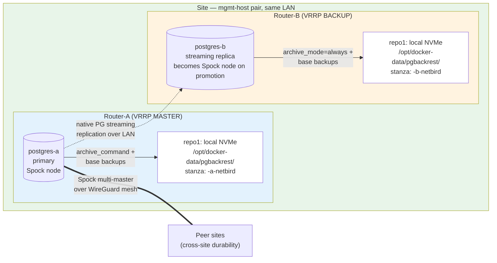

# pgBackRest — per-site sovereign backup & restore design

Per-site sovereign, island-mode-compliant backup design for the Netbird
mgmt-plane Postgres cluster. Each site runs **two independent pgBackRest
stanzas** — one on Router-A (VRRP MASTER, Spock node, Postgres primary)
and one on Router-B (VRRP BACKUP, Postgres streaming replica). Each
stanza backs up to its own host's local NVMe. No commercial cloud, no
cross-host SSH, no off-site S3 in the backup path. Cross-site site-loss
durability is carried by Spock multi-master replication, not pgBackRest.

Complements:

- `ha-multi-site.md` — cross-site Spock multi-master
  (island mode + site rebuild).
- `ha-failover.md` — intra-site VRRP failover between
  Router-A and Router-B.
- [`offline-enrollment.md`](offline-enrollment.md) — device re-enrollment
  path used in the total-loss scenario (§7.3 below).
- [`bootstrap-bundle.md`](bootstrap-bundle.md) — stateless architecture
  bundle used to stand up a fresh site or re-bootstrap after total loss.

**Status (2026-04-22):** final design after cloud → sovereign migration.
Implementation tracked in `../project/phase3-logistics.md`
and `../project/roadmap.md` Phase 2 row.

**Spock replication is not a backup.** It replicates DML eagerly, so
logical corruption (bad `TRUNCATE`, bad AutoMigrate) replicates to every
peer site as fast as the WAN allows. pgBackRest is the only mechanism in
the stack that supports point-in-time recovery (PITR) from before a
logical fault — and it is site-local by design so island mode never
loses its PITR capability.

---

## Table of contents

- [1. Why pgBackRest](#1-why-pgbackrest)
- [2. Topology](#2-topology)
- [3. Retention](#3-retention)
- [4. Schedule + WAL archiving](#4-schedule--wal-archiving)
- [5. Encryption at rest + key management](#5-encryption-at-rest--key-management)
- [6. Independent stanzas per host](#6-independent-stanzas-per-host)
- [7. Recovery runbooks](#7-recovery-runbooks)
- [8. Monitoring + alerting](#8-monitoring--alerting)
- [9. Phase 2 smoke test](#9-phase-2-smoke-test)
- [10. Open questions](#10-open-questions)
- [11. Related artifacts](#11-related-artifacts)

---

## 1. Why pgBackRest

| Option | What it gives us | Why it's insufficient on its own |
|---|---|---|
| **Spock logical replication** (cross-site) | Near-real-time cross-site copy for site-loss durability | Replicates DML corruption, accidental DELETEs, and app-level data bugs eagerly. No PITR. No recovery from WAL slot invalidation. Fine for site-loss, useless for corruption. |
| **Postgres streaming replication** (intra-site, Router-A ↔ Router-B) | Byte-for-byte replica on Router-B; supports sub-2-minute VRRP failover | Same corruption-replication flaw as Spock. Availability tool, not a backup. |
| **`pg_dump`** | Logical SQL dump | No WAL; RPO = last dump. Restoring large tables is slow. Doesn't catch on-disk corruption. |
| **`pg_basebackup`** | Physical full backup | No incremental / differential; every backup is a full copy. No built-in retention. Used here only for the Spock slot-rebuild runbook (§7.2), not for scheduled backups. |
| **pgBackRest** | Physical backups + continuous WAL archive + PITR + incr/diff + encryption + retention + restore helpers | Industry-standard; OSS; widely deployed; covers corruption + PITR that replication cannot. |

**Site-destruction scenario (accepted trade-off).** When both Router-A
and Router-B at a site are destroyed simultaneously, that site's
pgBackRest history is gone. The substitute is Spock replication to peer
sites — they hold the *current logical state* of the DB but not PITR
history. If pre-existing logical corruption replicated via Spock before
the destruction event, peer sites have inherited it and there is no
stanza to roll back. This is the known cost of hard-enforced
island-mode sovereignty; the alternative (a cross-site pgBackRest repo)
violates island mode by making backup ops dependent on WAN availability.

We keep `pg_basebackup` and `pg_dump` as secondary tools:

- `pg_basebackup` — Spock slot-rebuild runbook (§7.2).
- `pg_dump` — pre-upgrade schema snapshot (human-readable, small, cheap
  insurance against a bad AutoMigrate).

**Scheduled backup = pgBackRest.** Everything else supports it.

## 2. Topology

Every site is a Router-A / Router-B pair (see
`ha-failover.md`). Each host runs Postgres and its own
independent pgBackRest stanza, writing to its own NVMe. Two stanzas per
site, each self-sufficient.



**Two independent stanzas per site, not one shared repo.** Router-A's
stanza (`<site>-a-netbird`) covers Router-A's Postgres. Router-B's
stanza (`<site>-b-netbird`) covers Router-B's Postgres. Each stanza has
its own retention, its own cron, its own WAL archive — they don't share
any pgBackRest state. Host failure of either side leaves the other
stanza fully intact.

**Why independent stanzas rather than one stanza with `repo-host` over
SSH:**

1. **Decoupling.** Router-A's backup doesn't depend on SSH to Router-B
   being healthy. If the VRRP LAN interface is flapping, both stanzas
   keep running independently on each host.
2. **Simpler operational model per host.** Each host is self-sufficient;
   the scheduler, retention, and archive live entirely on one machine.
3. **No cross-host trust edge.** No SSH keys to manage between Router-A
   and Router-B just for backup transport.

### 2.1 Backup stream scope

Three databases live in each mgmt-plane Postgres cluster (see
`ha-multi-site.md` §5.1). pgBackRest works at the
**cluster** level — all three are captured by every backup. Scope
summary:

| Database | Captured by pgBackRest? | Cross-site replication? |
|---|---|---|
| `netbird` (peers, policies, groups, routes, setup_keys) | Yes — both stanzas | Spock multi-master |
| `netbird_idp` (Dex schema) | Yes — both stanzas | Not replicated (per-site Dex, see `ha-multi-site.md` §5.7) |
| `netbird_events` (audit log) | Yes — both stanzas | Not replicated (per-site by design, see `ha-multi-site.md` §5.6) |

**Out of scope for this design entirely:** tactical payload data stores
(Zenoh router storage, sensor and track stores). Those get separate per-service sovereign backup designs
in their own docs. Don't pile them onto the mgmt-plane stanza.

### 2.2 Island-mode requirement

Every backup path in this design stays on the mgmt-host's own NVMe.
**No backup operation depends on WAN connectivity.** During a WAN
outage, WireGuard-mesh partition, or contested-environment RF denial,
both stanzas continue running on their respective hosts with zero
degradation.

### 2.3 Configuration sketch (per-host)

On Router-A, `/etc/pgbackrest/pgbackrest.conf` (rendered by the
`pgbackrest` Ansible role):

```ini
[global]
repo1-path=/var/lib/pgbackrest
repo1-cipher-type=aes-256-cbc
repo1-cipher-pass=${PGBACKREST_REPO1_CIPHER_PASS}

repo1-retention-full=4
repo1-retention-diff=7
repo1-retention-archive=4
repo1-retention-archive-type=full

process-max=2
compress-type=zst
compress-level=3

log-path=/var/log/pgbackrest
log-level-console=info
log-level-file=detail

archive-async=y
spool-path=/var/spool/pgbackrest

[<site>-a-netbird]
pg1-path=/var/lib/pgsql/16/data
pg1-socket-path=/var/run/postgresql
pg1-port=5432
pg1-user=postgres
```

Router-B renders the same file with `<site>-b-netbird` as the stanza
name and the same local repo path (`/opt/docker-data/pgbackrest/` on
*Router-B's* NVMe — not the same disk as Router-A's, because they are
different hosts). Router-B's Postgres runs with `archive_mode=always`
so it archives WAL it received from Router-A via streaming replication
(§4 below).

No `repo2-*` block. No S3. No cross-account IAM. No AWS endpoint.
Nothing cloud-touching anywhere in this config.

## 3. Retention

Single repo per host (repo1 only). Retention is operator-tunable via
the `pgbackrest` Ansible role `defaults/main.yml`; these are the
recommended starting points.

| Policy | Value | Rationale |
|---|---|---|
| `repo1-retention-full` | `4` | Four weekly fulls. Covers most "oh no, what did we deploy three weeks ago" scenarios. |
| `repo1-retention-diff` | `7` | Seven dailies across the latest full. |
| `repo1-retention-archive` | `4` | WAL archive retained alongside the fulls (four weeks of PITR window). |

At our workload (single-digit GB cluster, single-digit writes/minute),
this occupies well under 100 GB of NVMe per host — trivial on the 1 TB
M.2 mounted at `/opt/docker-data`.

## 4. Schedule + WAL archiving

| Backup type | Frequency | Runtime budget |
|---|---|---|
| Full | Weekly (Sundays, low-traffic window) | < 30 min |
| Differential | Daily | < 5 min |
| Incremental | Every 6 h | < 1 min |
| WAL archiving | Continuous | Per-segment (16 MB) |

Implemented via host cron on each mgmt-host (see the `pgbackrest`
Ansible role `tasks/main.yml`). Each host runs its own schedule against
its own stanza independently.

### 4.1 `archive_mode` per role

**pgBackRest rejects `archive_mode=always`** (error [067] —
"archive_mode=always not supported"). Confirmed end-to-end on the
Wave 1.8 smoke test (2026-04-22). Any design that relied on the
replica independently archiving received WAL is therefore incorrect
as-stated.

Correct posture for a paired Router-A / Router-B topology with
streaming replication:

```
archive_mode = on
archive_command = 'pgbackrest --stanza=<site>-<role>-netbird archive-push %p'
```

on **both** Router-A and Router-B. Only the currently-primary host
actually fires `archive_command` (archive_mode=on archives only from
primaries). The standby receives WAL via streaming replication, not
via its own archive.

**Backup I/O offload.** To run the backup *job* from the standby (the
original motivation for `always`), use `--backup-standby=y` on the
`pgbackrest backup` command line, not `archive_mode`. pgBackRest
handles the cross-host coordination itself — the primary still
produces the archive, the standby serves the file reads during
backup. This requires pgBackRest to be able to reach both Postgres
instances (additional `pg2-host` config on the primary's stanza).

**Post-failover behavior.** When VRRP promotes Router-B to primary:

- Router-B's stanza (`<site>-b-netbird`) starts firing its
  `archive_command` (it's now primary). New WAL goes into its own
  stanza's archive.
- Router-A's stanza (`<site>-a-netbird`) freezes at whatever LSN it
  reached when Router-A died.
- When Router-A rejoins as streaming replica, its stanza stays
  frozen — replicas don't archive with `archive_mode=on`.
- When VRRP fails back (or never does), each stanza's "last active"
  timestamp records which side held primary during which window.

**Independent stanzas vs shared stanza.** The independent-stanza
design is still meaningful under this correction — each host writes
its own WAL to its own local repo when it's primary. The stanzas
don't share state. Cross-host restore from the "wrong" side (A down,
want to restore from B's stanza to A) requires either shipping B's
repo contents over or shipping A's entire archive history to B before
the failure. Single-host loss is covered by the surviving host's own
stanza; whole-site loss is covered by Spock, as in §1.

### 4.2 Schedule jitter (optional hardening)

Default cron runs every site's backup on the same UTC hour. Jitter each
host's schedule by ±30 min (`pgbackrest_cron_full_minute` etc. in the
Ansible defaults) to blur backup-cadence metadata if operationally
relevant. Default is no jitter.

## 5. Encryption at rest + key management

Each stanza uses `aes-256-cbc` at the repo level. **Two separate keys
per site** — one for `<site>-a-netbird` (Router-A's stanza), one for
`<site>-b-netbird` (Router-B's stanza) — so compromise of one host's
cipher key doesn't unlock the other host's repo.

Key storage:

- **1Password vault item per key:** `goat — pgBackRest <site>
  router-a` and `... router-b`. Never in `.envrc`, never in committed
  files, never in any cloud secret store.
- **Runtime:** the `pgbackrest` Ansible role reads the key from the
  operator's environment (sourced from 1Password CLI at deploy time)
  and the container reads it from a tmpfs-backed secret file. Keys
  evaporate on reboot; re-populated on the next Ansible run.
- **Rotation:** pgBackRest does not support key rotation without
  re-encrypting the entire archive. To rotate, create a new stanza
  (`<site>-a-netbird-v2`) with a new key, run a full backup, wait for
  retention to expire the old stanza, then drop it. Practical cadence:
  annually or on compromise.

No Shamir split, no key ceremony, no offline CA signing of the pgBackRest
cipher key. Keys are sovereign-held via 1Password + Ansible vault and
never leave the operator workstation or the mgmt-host's tmpfs during
the deploy window. The heavy key-custody machinery (YubiKey Shamir,
offline CA signing) is reserved for the
[bootstrap bundle](bootstrap-bundle.md) — which lives in cloud and
needs the extra ceremony — not for the intra-site pgBackRest keys.

### 5.1 Setup-key TTL coupling

`setup_keys.key` and `setup_keys.key_secret` are unencrypted bearer
tokens inside the Postgres DB (see the identity audit in
`ha-multi-site.md` §5.2). A pgBackRest archive
captures these as ciphertext under the repo cipher pass; if an attacker
ever recovered both an old backup and the sovereign cipher key, they
would have a snapshot of setup keys valid at that moment.

Mitigation: the role-scoped setup-key TTLs (1d bootstrap / 7d admin /
30d operator / 90d peer, see
[`../operations/setup-key-rotation.md`](../operations/setup-key-rotation.md))
and daily auto-revoke cron ensure that setup keys in any backup older
than the longest TTL (90 d) have already expired. The
`repo1-retention-archive=4` default (four weeks) is well inside that
envelope — expired-in-cloud backups contain only expired keys.

**Rule:** `max(setup_key_ttl) ≤ pgbackrest_repo1_retention_archive`.
If the retention window is ever extended beyond the longest TTL,
reduce the longest TTL to match.

## 6. Independent stanzas per host

pgBackRest's canonical advice is "one backup node per stanza" — because
two pgBackRest installs writing to the same repo with the same stanza
name would produce divergent WAL histories and confuse the archive.

This design sidesteps that concern by using **different stanza names**
per host (`<site>-a-netbird` vs `<site>-b-netbird`). Each stanza has
its own repo path, its own WAL archive, its own retention state. They
share only the underlying Postgres cluster's `system identifier` (because
Router-B was cloned from Router-A via streaming replication), but
pgBackRest tracks state per stanza, not per system identifier.

Consequences, all acceptable:

- **Divergent WAL archives across hosts.** Router-A's stanza archives
  what Router-A wrote; Router-B's stanza archives what Router-B
  received. During normal operation these are byte-identical in
  content, but pgBackRest treats them as separate backup chains.
  Storage overhead is ~2× the single-stanza footprint (still trivial on
  1 TB NVMe).
- **Restore picks best-available stanza.** Operator examines both
  stanzas' `pgbackrest info` and restores from whichever has the most
  recent viable backup.
- **No cross-host backup coordination.** Schedules run independently;
  if Router-A's backup hangs, Router-B's is unaffected.

### 6.1 Scope per stanza

Both stanzas back up the full cluster: `netbird`, `netbird_idp`, and
`netbird_events`. pgBackRest operates at cluster granularity, not
per-database. The replication scope for each DB (multi-master vs
per-site) is a separate concern handled in `ha-multi-site.md`; backup
scope is always the whole cluster.

### 6.2 Post-restore Spock re-subscribe

A full restore from pgBackRest rewinds the restored host's Postgres
state — including any Spock replication slot positions. After restoring
Router-A (or Router-B post-promotion), the restored host's Spock
subscriptions to peer sites must be dropped and recreated. Full
procedure in §7.1 below; runbook aligns with
`ha-multi-site.md` §7 (operational risks &
mitigations) and the existing coordinated-upgrade playbook.

## 7. Recovery runbooks

### 7.1 Single-node restore from pgBackRest

Use when: one host's Postgres data is corrupt, the NVMe failed, the
host was reimaged, or logical corruption replicated via Spock and we
need PITR to before the event.

```bash
# On the affected host (Router-A shown; Router-B procedure is
# symmetric — substitute postgres-b and <site>-b-netbird).

# 1. Stop the management + PG containers on this host.
docker compose -f /opt/mgmt-host/docker-compose.yml stop management-a postgres-a

# 2. Clear the corrupt data directory.
docker compose -f /opt/mgmt-host/docker-compose.yml rm -s -f postgres-a
docker volume rm mgmt-host_pgdata-a

# 3. Pick the stanza with the most recent viable backup. On a healthy
#    pair both stanzas are current; after a failure decide between
#    local (<site>-a-netbird) or peer (<site>-b-netbird via ssh to
#    Router-B). In practice operator runs:
ssh router-a "docker exec postgres-a pgbackrest --stanza=<site>-a-netbird info"
ssh router-b "docker exec postgres-b pgbackrest --stanza=<site>-b-netbird info"
# Pick whichever has the most recent backup covering the target timestamp.

# 4. Restore. Default = latest. Point-in-time = --type=time --target='...'.
#    If restoring from the local (Router-A) stanza:
docker run --rm \
  -v /opt/docker-data/pgbackrest:/var/lib/pgbackrest:ro \
  -v mgmt-host_pgdata-a:/var/lib/pgsql/16/data \
  pgbackrest/pgbackrest:latest \
    --stanza=<site>-a-netbird \
    --pg1-path=/var/lib/pgsql/16/data \
    restore

#    If the local stanza is unavailable (NVMe died), scp the relevant
#    repo subtree from Router-B, or mount Router-B's NVMe temporarily
#    over NFS/sshfs. Then restore pointing at <site>-b-netbird.

# 5. Bring Postgres up and verify.
docker compose -f /opt/mgmt-host/docker-compose.yml up -d postgres-a
docker exec postgres-a psql -U postgres -c "SELECT pg_last_wal_replay_lsn();"

# 6. On EVERY peer site, drop + recreate the Spock subscription TO
#    this node (cluster identity may have changed via PITR timeline).
#    Run on each peer's postgres-a:
SELECT spock.sub_drop('sub_from_<this-site>');
SELECT spock.sub_create(
  subscription_name := 'sub_from_<this-site>',
  provider_dsn := 'host=<this-site-mesh-ip> dbname=netbird user=replicator password=...',
  replication_sets := ARRAY['default']
);
SELECT spock.sub_wait_for_sync('sub_from_<this-site>');

# 7. Start the management container back up.
docker compose -f /opt/mgmt-host/docker-compose.yml up -d management-a
```

**Red flags:** `pg_last_wal_replay_lsn()` returns NULL → restore didn't
pick up WAL. `sub_wait_for_sync` hangs > 10 min → check
`pg_stat_replication` on the provider side.

### 7.2 Slot-rebuild via pg_basebackup

Unchanged from `ha-multi-site.md` §7.2 — faster than
full pgBackRest restore for the common "slot went invalid during a long
partition" case. pgBackRest is for actual data loss; `pg_basebackup` is
for rejoining Spock after WAL retention broke.

### 7.3 Site-loss recovery paths

Branches by loss scope. The old "restore every site from off-site
repo2" runbook is retired — the new design has no off-site backup.

#### 7.3.1 Single-host NVMe loss

Router-A's NVMe died, Router-B is healthy.

- **Short path.** VRRP has already failed over to Router-B as the new
  primary. Order a replacement NVMe; rebuild Router-A via the existing
  Ansible role (`ops/ansible/roles/pgbackrest/`); Router-A rejoins as
  the new streaming replica; streaming replication re-syncs its data
  dir; `<site>-a-netbird` stanza starts a fresh backup chain on the new
  disk. No pgBackRest restore needed — streaming replication does the
  rebuild.
- **Lost stanza history.** The old `<site>-a-netbird` archive is gone.
  `<site>-b-netbird` on Router-B still has full history. For any
  PITR-to-before-NVMe-loss case, restore from `<site>-b-netbird`.

#### 7.3.2 Single-site full loss (both hosts destroyed)

Entire Router-A + Router-B pair gone. At least one peer site survives.

Spock replication to peer sites has already carried the *current
logical state* of `netbird` + `netbird_idp` to them. Rebuild the lost
site by:

1. Stand up fresh mgmt-host hardware (Router-A + Router-B) per
   `../operations/pilot-bringup.md`.
2. Deploy the mgmt-host stack via the standard Ansible path.
3. On the fresh Router-A: `spock.node_create` as a new Spock node at
   this site; `spock.sub_create` subscribing to the nearest surviving
   peer site. Do NOT try to recreate subscriptions to the destroyed
   site's old cluster — its cluster identity is gone.
4. Wait for initial Spock sync (`spock.sub_wait_for_sync`).
5. Bring Router-B up as streaming replica.
6. Pre-existing site-local data that was not replicated
   (`netbird_events`) is unrecoverable from backup — it's gone with
   the site. Application-layer audit trail for this site restarts
   fresh.

See `ha-multi-site.md` §7 for Spock-specific
site-rebuild caveats (WAL retention, initial-sync observability,
subscription direction).

**Accepted limitation.** If logical corruption had replicated from the
destroyed site to peer sites before the destruction event, peer sites
have inherited it and there is no stanza to roll back from. This is
the site-destruction + pre-existing-corruption case; mitigation is
detection speed (Spock conflict alerting, §8 below), not backup.

#### 7.3.3 Total-loss — every site destroyed simultaneously

No backup survives this. No pgBackRest recovery path exists.

The remaining artifacts are: the git repository (infrastructure as
code), operator knowledge, the offline CA private key (on a YubiKey in
operator custody — outside any destroyed facility), and whatever
pre-distributed offline-enrollment bundles surviving devices still
hold.

Recovery sequence:

1. Pull the signed & encrypted
   [bootstrap bundle](bootstrap-bundle.md) from its cloud storage.
2. Verify signature (offline CA public key) and decrypt with the
   operator's age recipient key.
3. Terraform + Ansible the whole stack from scratch: fresh relays (or
   re-use the surviving ones), fresh mgmt-host pair at a surviving
   location, fresh Spock cluster seeded from nothing.
4. Issue fresh setup keys; re-enroll surviving devices via
   [`offline-enrollment.md`](offline-enrollment.md) using the offline
   CA to validate device-held bundles.
5. Accept that historical mesh state (peer identities, historical
   policies, activity logs) is lost. Operational posture restarts
   fresh.

Expected RTO: ~4–8 h dominated by hardware provisioning + Spock
initial sync. RPO is effectively "everything since the system last
stood up" — because there is no state to restore to.

## 8. Monitoring + alerting

Integrated with the monitoring skeleton at
[`../../ops/monitoring/`](../../ops/monitoring/).

| Alert | Trigger | Severity |
|---|---|---|
| `PgBackRestJobFailed` | Last backup job exit != 0 on either stanza | critical |
| `PgBackRestBackupOverdue` | No successful full on a stanza for > 10 d (cadence 7 d + buffer) | critical |
| `PgBackRestWALArchiveOverdue` | No WAL segment archived by a stanza in > 15 min | critical |
| `PgBackRestArchiveModeWrong` | Router-B's `archive_mode` != `always` (config drift) | warning |
| `PgBackRestStanzaDiverged` | `<site>-a-netbird` and `<site>-b-netbird` last-backup timestamps differ by > 2 h (one host's scheduler is failing silently) | warning |

Metrics sourced from a `pgbackrest info --output=json` scrape via the
[`pgbackrest-exporter`](https://github.com/woblerr/pgbackrest_exporter)
sidecar on each host. Separate PR wires this into the existing
Prometheus scrape config.

## 9. Phase 2 smoke test

Runs on a **purpose-built ephemeral cloud env**, not on hadev
(hadev is running the 72h Wave 3 soak and must not be disturbed).
Terraform + runbook for the Wave 1.8 env:

- Terraform: `../../terraform/pgbackrest-wave18.tf` — one amd64 EC2, `TeardownBy=wave-1.8-smoke-test-complete`.
- Orchestrator: [`../../ops/ansible/pgbackrest-wave18.yml`](../../ops/ansible/pgbackrest-wave18.yml) — brings up the mgmt-host stack with the phase2 overlay (postgres-a + postgres-b on one host), deploys both stanzas independently.
- Operator runbook: `../operations/pgbackrest-wave18-validation.md`.
- Lifecycle tracking: `../operations/cloud-env-lifecycle.md`.

The ephemeral single-host env uses the phase2 compose overlay to stand
up `postgres-a` AND `postgres-b` on one machine with distinct host
bind-mounts (`/opt/docker-data/pgbackrest` for A,
`/opt/docker-data/pgbackrest-b` for B). This exercises the role's
Router-B parametrization (`postgres_container_name=postgres-b`,
`pgbackrest_archive_mode=always`, per-stanza path overrides) end-to-end
without touching hadev / integdev. The env is destroyed
immediately after the smoke test passes.

See the linked operator runbook for the complete procedure. Summary
(full steps + pass criteria in the runbook):

1. Bootstrap `wave18-a-netbird` on postgres-a and `wave18-b-netbird` on
   postgres-b. Each stanza writes to its own distinct host path. Confirm
   both report an initial full backup via `pgbackrest info`.
2. Verify postgres-b is running with `archive_mode=always` and its
   stanza is receiving WAL segments (`pg_stat_archiver.archived_count`
   > 0).
3. Insert a known-marker row on postgres-a; mirror it on postgres-b
   (single-host env runs them as independent clusters for the smoke
   test — separate-host streaming replication is covered by hadev).
4. Run `pgbackrest backup --type=incr` on both stanzas. Both complete
   cleanly.
5. DROP the marker row on postgres-a (simulating accidental DELETE).
6. Restore postgres-a from `wave18-a-netbird` with
   `--type=time --target='<just before the DROP>'`.
7. Verify the marker row is back on postgres-a.
8. Capture evidence (`pgbackrest info` + `pg_stat_archiver` dumps).
9. **Teardown** — `terraform destroy` the whole env per
   `../operations/pgbackrest-wave18-validation.md`
   §5. This is mandatory; the env is tagged ephemeral for a reason.

Capture wall-clock for each step. Expected total ~60-90 min end-to-end
(provision → bootstrap → drill → teardown).

**Host-loss drill** (peer-hosted Router-B survives Router-A crash) is
not covered by this single-host env — it requires the paired-host
topology which lands with Phase 3 hardware. Documented as a follow-on
in `../project/roadmap.md` Phase 3.

## 10. Open questions

1. **Site-destruction RPO quantification.** With cross-site durability
   carried by Spock alone (no pgBackRest off-site), the worst-case RPO
   for a single-site full loss equals Spock's replication lag at the
   moment of destruction. We need a measured value under load to
   publish as the official RPO. Measure during Wave 1.8 and Wave 3
   drills.
2. **`archive-async` spool persistence across postgres container
   restarts.** Current role compromise (per
   `ops/ansible/roles/pgbackrest/tasks/main.yml`) leaves the spool dir
   inside the container's ephemeral filesystem. Phase 3 compose
   refactor should bind-mount `/var/spool/pgbackrest` from host into
   postgres to survive container restarts without WAL re-push churn.
3. **Per-host process-max tuning.** A 12-core or 8-core host can run
   `process-max=4` safely; a 2-vCPU host
   caps at 1–2. Document per-hardware defaults.
4. **Bundle the §7.1 restore drill into routine ops cadence.** A
   quarterly walked-through restore drill (non-prod, time-boxed)
   prevents the "works until you need it" failure mode. Add to Phase 3
   operational calendar.

## 11. Related artifacts

- Ansible role: [`../../ops/ansible/roles/pgbackrest/`](../../ops/ansible/roles/pgbackrest/)
  (defaults, tasks, template, README).
- Config template: [`../../ops/ansible/roles/pgbackrest/templates/pgbackrest.conf.j2`](../../ops/ansible/roles/pgbackrest/templates/pgbackrest.conf.j2).
- Reference config (kept in sync manually): `../../ops/pgbackrest/pgbackrest.conf`.
- Compose overlay: [`../../ops/compose/mgmt-host/docker-compose.pgbackrest.yml`](../../ops/compose/mgmt-host/docker-compose.pgbackrest.yml).
- Spock-enabled Postgres image (includes pgBackRest binary baked in): [`../../ops/postgres/spock/Dockerfile`](../../ops/postgres/spock/Dockerfile).
- Monitoring rules (skeleton source of truth): [`../../ops/monitoring/prometheus/rules/pgbackrest.yml`](../../ops/monitoring/prometheus/rules/pgbackrest.yml). Per-site copy lands at `../../ops/compose/mgmt-host/monitoring/rules/pgbackrest.yml` when the `pgbackrest-exporter` sidecar is wired into mgmt-host compose (mirrors the spock.yml / ntp.yml / signal-server.yml pattern).
- Wave 1.8 smoke-test checklist: [`../operations/goat-ha-dev-validation.md`](../operations/goat-ha-dev-validation.md).
- Bootstrap bundle (total-loss path): [`bootstrap-bundle.md`](bootstrap-bundle.md).
- Offline enrollment (device re-enrollment in total-loss): [`offline-enrollment.md`](offline-enrollment.md).

