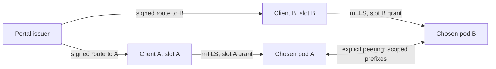

# Pod-targeted client bundles — implementation design for issue 1556

Status: proposed design, 2026-10-01. This is source-based research. No containers, local credentials, router processes, or new live peering were used. The first scope is **one explicitly chosen, internally operated ZAGROS pod** for a newly enrolled client. Automatic nearest-pod selection and partner-custodial federation are later decisions.

The first issuer path is `goat machine enroll` for a new machine client. The portal also uses `certmint.Mint` for operator/person onboarding and rotation (`internal/api/handlers.go`); those callers would continue to receive the configured central endpoint until they adopt the same resolver and authorization contract. Existing enrolled clients need a route-only update path, described below. A first implementation must label these limits in its API and release notes rather than imply that every bundle type is pod-targetable.

## Contract and roles

An enrolled client receives a signed bundle naming the pod router it is authorized to use. `goat profile init` verifies that bundle and installs the route. `goat pub`, `goat sub`, and diagnostics use the same selected route. The pod admits the client's own slot namespace, and its peering policy determines what may cross to another router. The bundle does not itself make a pod reachable or authorize traffic at the pod.

Do not overload the pod's own enrollment bundle. In `zagros-moon-pod/host/first-boot.sh`, the current `goat_cli_extras.router_endpoint` is read from the pod's profile as `ZENOH_FABRIC_ENDPOINT`, the router's **outbound** destination. In a legacy client bundle, that field is the client's **attachment** destination. Supplying a pod-targeted client bundle to first-boot could make the pod dial itself. Keep the pod's own upstream/peer topology declaration distinct from client attachment policy, and change first-boot to reject a self endpoint before offering any pod-targeted pod bundle.



For a local-only attachment milestone, remove the A↔B link from the claim. A signed pointer to pod A does **not** prove central-independent A↔B delivery. The future two-pod subscriber test in the research plan is the separate routing gate.

## Current path, observed in source

1. `ops/goat-zenoh-portal/internal/config/config.go` reads one `PORTAL_ROUTER_ENDPOINT` per portal process. `internal/certmint/certmint.go` passes it as `--goat-cli-router-endpoint` for every mint, including `POST /api/machines/enroll` (`internal/api/machine_enroll.go`). `Mint` also creates a new leaf and private key. It has no route-only reissue path.
2. `ops/enrollment/cmd/bundle-create/goatcli.go` validates the locator and creates `GoatCLIExtras`. `ops/enrollment/bundle/bundle.go` signs the CBOR with one `router_endpoint` alongside the portal token and mTLS material. The locator validator accepts several transports; a pod-targeted ZAGROS policy should require `tls/`.
3. `crates/goat-cli/src/bundle.rs` verifies the signature and reads the one endpoint. `cmd/profile.rs` writes it to `profile.toml`; `cmd/pubsub.rs` opens Zenoh in `client` mode against that profile value. `status`, `doctor`, `heal`, and other commands use the same value through several separate readers. A changed profile file is not rechecked against the signed bundle on every connection.
4. `zagros-moon-pod/host/zenoh-router.json5.tmpl` listens for mTLS clients, but its current ACL only grants its own `${PARTNER_NAMESPACE}/**` plus `${INBOUND_NAMESPACE}/**`. It has no per-client slot attachment grants. Its current `connect` target is the central fabric endpoint.
5. `crates/panoscope-core/src/tls.rs` sets `verify_name_on_connect: false`. CA-chain validation remains, but a signed endpoint string is **not** cryptographically bound to a particular pod certificate today. The portal's machine leaf gets `serverAuth`, but `certmint.go` gives it a `client.<anchor>.<suffix>` DNS SAN, which need not match the pod's chosen mesh name. A new strict route must solve the certificate/name match instead of treating a successful CA validation as pod identity verification.

[ADR 1020](../adr/1020-zenoh-federated-peering-trust-model.md) explains why the receiving router sees the forwarding router's identity, not the originating client's certificate.

## Proposed first bundle contract

Use two mutually exclusive shapes in `goat_cli_extras`: a legacy bundle keeps `router_endpoint`, while a pod-targeted **client** bundle carries `router_binding` and omits `router_endpoint`. Today an old CLI requires `router_endpoint`, so it will refuse the targeted bundle instead of silently routing through a different endpoint without checking pod identity. A new CLI accepts either shape and writes the selected endpoint to its profile for compatibility with existing local readers. The proposed signed binding is:

```text
router_binding: {
  version: 1,
  pod_anchor: <registered machine slot anchor>,
  pod_handle: <display handle, never an authority by itself>,
  endpoint: "tls/<pod-mesh-dns-name>:7447",
  selection: "explicit",
  policy_generation: <monotonic registry generation>
}
```

Reject a bundle containing both route fields or neither at issuance and in the new verifier. The signing boundary is the existing canonical CBOR signature; no separate signature scheme is needed for this initial bundle. Require the DNS host in `router_binding.endpoint` to equal a SAN on the pod listener cert and enable Zenoh listener-name verification for this route. This avoids depending on an unconfirmed separate TLS-server-name override. The portal's current machine SAN is `client.<anchor>.<suffix>`; either make that exact name resolvable as the pod endpoint or issue an appropriate router-listener SAN/cert before using the binding. An IP locator without a matching IP SAN is not a strict binding.

The binding identifies an **attachment target**, not a claim that the pod may federate arbitrary keys. The portal token, client cert/key, slot anchor, CA roots, and bundle lifecycle stay tied to the client. A pod target must not change them. Old bundles retain their present one-endpoint behavior. New CLI versions must enforce the exclusive route shape and verify the installed signed bundle when resolving a targeted route. Old CLIs fail at `profile init` on a targeted bundle; release instructions must state the minimum CLI version. This is a deliberate compatibility boundary, not an implicit central fallback.

For moving an already enrolled client, do not call `Mint` or `goat machine enroll` again: both create new credentials and enrollment has quota effects. Specify a later route-only, signed policy update tied to the existing slot and current certificate, with its own monotonic generation, expiry, and revocation semantics. Until that exists, the first slice covers **new client enrollment only**. `profile rotate` with a new full bundle is credential rotation, not a safe generic router-switch command.

## Portal decision and issuance path

| Decision | Proposed server-side rule |
|---|---|
| Target request | Add optional `router_handle` to single-machine enrollment and `goat machine enroll --router <handle>`. Omission uses the configured central endpoint and the old bundle shape. For bulk enrollment, defer router choice or add one common target for the whole request; do not silently infer a pod per item. |
| Target resolution | Resolve handle to one live pod-class registry anchor. Store an operator-approved attachment endpoint, TLS name/cert identity, owner/trust tier, and route-policy generation with that anchor. A machine row alone currently lacks those serving fields. Reject arbitrary caller-supplied locator strings. |
| Client eligibility | For the first internally operated ZAGROS pilot, register a pod as accepting the same pre-cut, same-goatnet slot pool as the core router; match the enrollment class and trust domain to that declared scope before allocation. This is a broad **internal-parity** admission decision, not a per-client grant. A narrower per-client/custodian grant is separate work for pods that should not accept every enrolled slot. |
| Readiness | Require a current authenticated Zenoh session probe and a published pod listener/ACL configuration generation matching the core slot-pool parity baseline. `nc -z`, enrollment status, or a NetBird peer listing is insufficient. Define probe freshness and a clear refusal when evidence expires. This is a future system check, not performed in this design phase. |
| Issuance | Pass the resolved endpoint and binding into the per-request mint options, through `certmint` to `bundle-create`. Keep process-wide `PORTAL_ROUTER_ENDPOINT` as the default only. Record chosen pod anchor and policy generation against the issued bundle for audit. |
| Failure | Refuse before allocating a client slot if the requested pod is unknown, unauthorized, not ready, or has no verifiable listener identity. If a post-allocation failure occurs, use the existing enrollment rollback path. Never fall back silently to central after an explicit choice. |

The portal must authorize an attachment *before* making a signed pointer to it. For the internal pilot, the pod's ACL already needs the complete approved slot-pool parity render before it is marked ready, so a new slot does not trigger a router restart in the enrollment request. If the pod has a narrower grant list, provisioning a new client's anchor requires an explicit stage/deploy/verify step before bundle release; do not pretend the current synchronous enrollment endpoint can do that atomically. A signed bundle cannot repair a missing pod ACL.

## Per-hop authority for the controlled ZAGROS pilot

Use `slotA/**` and `slotB/**` below as placeholders for the real 32-hex slot-root key expressions; render actual anchors from the registry, never from a caller's text.

| Hop | Authenticated identity | Required admission | Must be denied |
|---|---|---|---|
| Client A → pod A | Client A leaf CN/slot anchor | `put/delete` ingress on `slotA/**`; subscription/read only on the recipient scopes granted to A | `put` on `slotB/**`, `ops/**`, `cmd/**` merely by attaching to A |
| Client B → pod B | Client B leaf CN/slot anchor | Equivalent own-slot and recipient grants | Cross-slot writes |
| Pod A → pod B | Pod A **router** identity | Ingress only on shared/released prefixes expressly listed for this peering; matching subscribe/delivery rules | `**` ingress, unlisted slot roots, authority-bearing prefixes |
| Pod B → client B | Client B identity at pod B | Delivery/read only for B's granted scopes | Any data outside B's recipient grants |

Native router peering loses per-client certificate identity at the router hop. For this pilot, pod B may trust pod A to have enforced A's ingress ACL **only if** both are under one operational trust/parity contract and pod A's router identity is bound to that contract. Pod B still restricts the peer to a declared set of prefixes. A partner-custodial pod needs an origin-preserving gateway or release namespace design; do not reuse this internal-parity trust rule for it. Key names or sample payload metadata can aid audit but cannot by themselves prove the original cert.

## Code boundaries and order

1. **Pod admission and identity specification:** define router listener identity, DNS/SAN, a same-goatnet slot-pool parity baseline, and its exact ACL render for the controlled pod. Update `zagros-moon-pod` first-boot and template only after that contract is approved. Treat its separate repository as a separate change/review. Keep the pod's own upstream/peer config separate from client bundle routing. A narrower per-client grant path is later work.
2. **Portal registry and API:** add registered pod endpoint/identity/readiness metadata and attachment grants under `ops/goat-zenoh-portal/internal/registry` and API. Add optional handle to single enrollment, resolve and authorize it before slot allocation, and thread an immutable resolved binding through `certmint.MintOptions`. Avoid mutating the shared `Minter.RouterEndpoint` per request. Update portal OpenAPI and Rust `panoscope-core` request type.
3. **Signed artifact:** add the alternate binding to Go `GoatCLIExtras` and `bundle-create` flags. Make exactly one of legacy endpoint or targeted binding mandatory when extras are present. Cover CBOR roundtrip, tamper, both/neither refusal, malformed locator, and old-bundle compatibility. Old CLIs should reject targeted bundles because the legacy endpoint is absent.
4. **CLI consumer:** parse and validate binding in `crates/goat-cli/src/bundle.rs`; install it with the verified bundle in `cmd/profile.rs`. Introduce a shared route resolver for pub/sub, status, doctor, heal, audit, top, flow, and any other Zenoh opener/label. For targeted routes, enable listener-name verification and report the actual selected endpoint. Preserve legacy behavior for old bundles while naming that limitation.
5. **Inter-pod routing:** add explicit peer endpoints and reciprocal scoped ACLs only after the client attachment path is sound. The current core `router-peer` rule keys on `goat-zenoh-router` and only admits `ops/**` plus `attest/schema/**`; it is not a pod grant. A controlled same-goatnet peer rule and explicit prefix list are separate topology changes.
6. **Later movement/selection:** define signed route-only updates and deterministic fallback; then measured closest-pod choice. An explicit pod selection fails visibly if unavailable. Automatic mode may choose only among signed, authorized, identity-checked candidates.

## Acceptance and unresolved points

The desk-design gate is complete when the authority matrix, pod listener identity strategy, internal slot-pool parity contract, and `router_binding` wire schema are agreed. Code gates are then: legacy bundle compatibility; target resolution and refusal tests; a signed bundle/profile/CLI unit path using fixture material; pod ACL render checks; and finally the future live two-pod test matrix in the research plan. No local credentials or containers are required for this design gate.

Open decisions: whether pod enrollment uses a dedicated listener certificate or the existing machine leaf with a resolvable matching SAN; who approves attachment grants for a custodian's clients; how grant revocation reaches offline pods; whether the central router is ever an explicitly signed fallback; and which slot/release prefixes are shared in the first cross-pod proof. None of these should be silently filled in by the endpoint flag.
