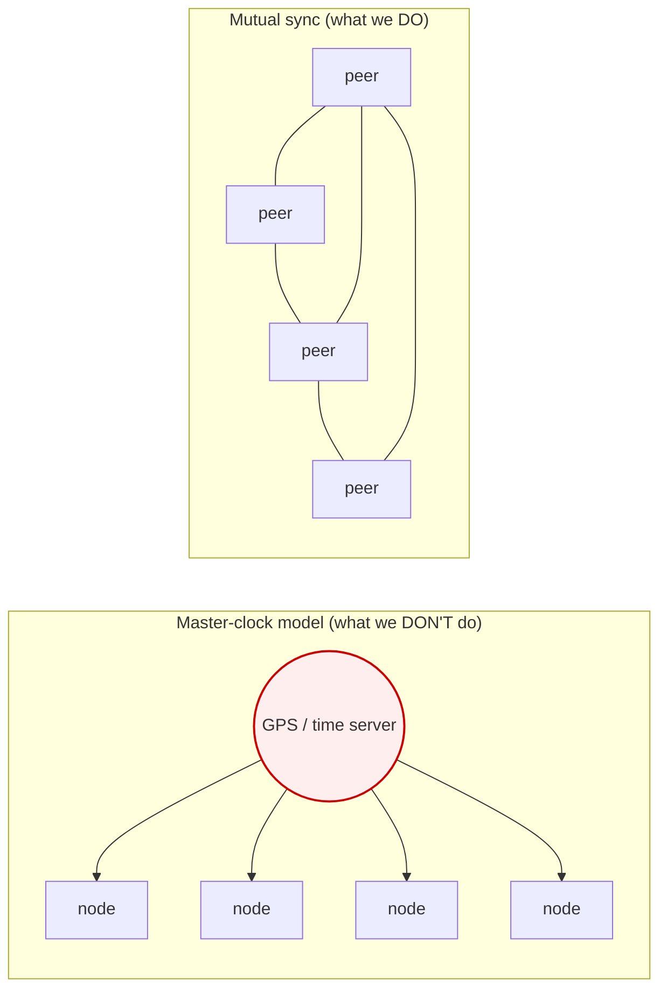
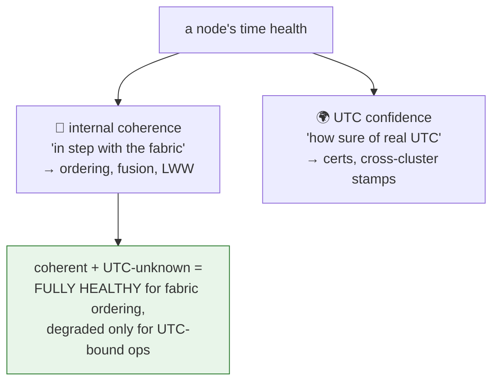
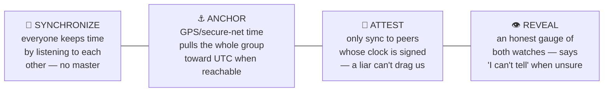
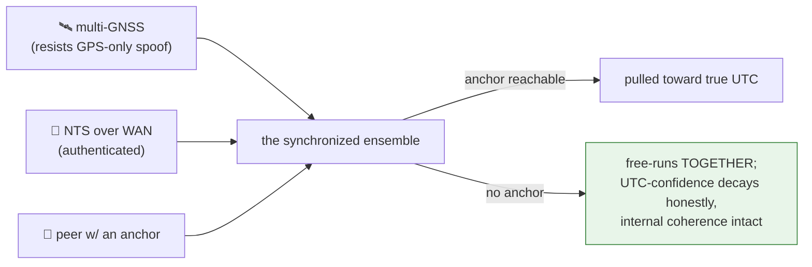
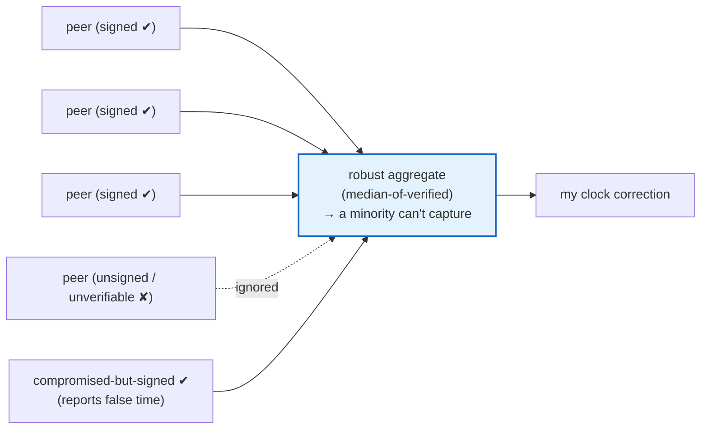
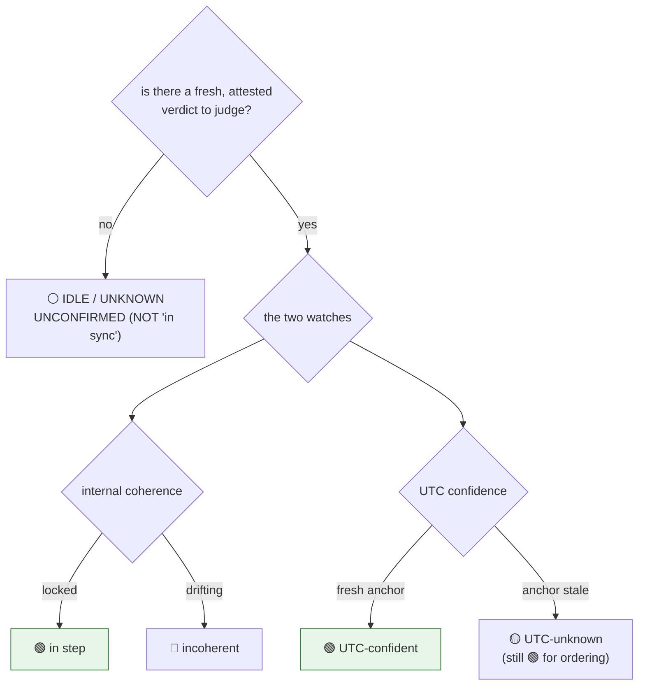
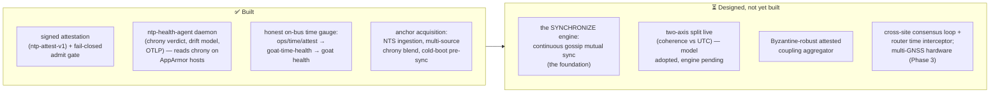

# Keeping time together — how the fabric stays in sync when GPS is gone

> **A standalone guide, two reading levels.** Each idea is explained first in plain language
> (the **In short** line), then with the real mechanism (the **Deeper** note). If you only read
> the **In short** lines and look at the pictures, you'll get the whole story. The canonical
> detail lives in the design docs and ADRs linked at the end — this guide is the map, not the
> territory. It is the time-hygiene companion to the quality-of-service guide
> ([`qos-mission-critical-protection.md`](https://github.com/usareur-af/goatdocs/blob/main/docs/design/qos-mission-critical-protection.md)).

---

> **Runnable companion.** `hello-galaxy-time-hygiene` (Hello Galaxy series) walks this model in six scenarios — five of which need no infrastructure. It verifies a real `ntp-attest-v1` signature against a readable reference, exercises the five-state honesty grading, models the liar and the anchor-loss cases the engine would handle, and reproduces the RTC-less cold-boot failure with openssl. Its `docs/honesty-matrix.md` is the one place the live-versus-designed line is drawn for the whole time domain.

---

## The promise, in one paragraph

Every node on the fabric stamps its data with a time, and consumers **order, correlate, age-out,
and fuse** events by those stamps — which track came first, which detection goes with which alert,
which write wins. For all of that, the one thing that truly matters is that participants **agree
with each other about time** — not that each is individually correct against the world's official
clock. This guide explains how the fabric keeps everyone **in step even when GPS is jammed and the
network to the outside world is cut** (that's the *normal* condition at the tactical edge, not the
exception), how it still tracks true UTC *when it can* without depending on it, how it keeps a
**liar** from dragging everyone's clock, and how it tells you — honestly — when it doesn't know.

---

## 1. The hard part: there is no master clock — and you can't trust GPS

**In short.** The instinct is to have one trusted clock — a GPS receiver, an official time server —
that everyone else copies. But the fabric lives exactly where that breaks: GPS gets **jammed and
spoofed**, and the link to the outside world gets **cut**. A design that leans on an outside clock
is a fair-weather design — it fails in precisely the weather the fabric is built for. So instead of
copying one master, **everyone keeps time by listening to each other** — like a band staying
together by ear when the conductor walks off stage.

**Deeper.** The fabric is **brokerless** — no central component sits in the data path, and that
includes time: there is **no central time master, no elected time authority** (a captured or lost
master would take the fabric's time with it). The foundation is **internal synchronization**: every
participant continuously runs peer-to-peer mutual time sync (gossip-based adaptive coupling), so the
fabric holds a common, *relatively-consistent* time **with no external reference required**. This is
the regime Corsaro designed gossip internal-synchronization for — and he went on to design **Zenoh,
our fabric**. The substrate's own author already concluded internal peer sync is the time model for
this environment ([ADR 1037](../adr/1037-fabric-internal-time-synchronization-first.md)).

*Jam or spoof the one master and every node that copied it goes wrong together — silently. A band
keeping time by ear loses the wall-clock, but never loses each other.*

> **Why "keep each other" beats "keep your own crystal."** The old fallback was: when a node loses
> its sources, it free-runs on its own oscillator (holdover). The problem is that every isolated
> node free-runs *independently*, so they **drift apart** from one another — destroying the
> event-correlation the fabric needs at the exact moment the outside reference is gone. Mutual sync
> keeps the islanded nodes drifting *together*, which is what ordering and fusion actually require.

---

## 2. The two clocks: "in step with us" vs "matches the world"

**In short.** Think of every node wearing **two watches**. One says **"how in-step am I with
everyone around me?"** — that's what you need to order events and merge tracks. The other says
**"how sure am I of the real, official time?"** — that's what you need for things like certificate
expiry. The key insight the old design got wrong: these are **different watches**, and a node can be
perfectly in-step with the fabric while honestly unsure of the world's clock. **That state is
healthy** — for everything the fabric does moment-to-moment.

**Deeper.** Time health is split into **two independent axes** (replacing the single old verdict):

| The watch | Axis | Answers | Governs | At the denied edge |
|---|---|---|---|---|
| 🤝 **In step** | **internal coherence** | locked to the fabric ensemble within bounded sync error? | event ordering, fusion/correlation, multi-master last-write-wins | **holds** — this is what mutual sync preserves |
| 🌍 **The world** | **UTC confidence** | how well/recently is the ensemble anchored to true UTC? | cert / JWT / setup-key validity, cross-cluster + human-facing timestamps | **decays honestly** — and that's fine for ordering |

*Conflating these two into one "is the clock OK?" number was the foundational error. A denied-edge
node that's in-step-but-UTC-unsure is the **common, correct** operating state — it must read as
healthy for ordering, not falsely as "unhealthy."*

---

## 3. The four pillars

Everything rests on four ideas. **Synchronize** keeps everyone in step; **Anchor** pulls the whole
group toward true UTC when it can; **Attest** makes sure a liar can't drag the group; **Reveal**
shows the picture honestly. Anchoring is the bonus on top — it is *never* the foundation.

### Pillar 1 — Synchronize: the band keeps time by ear

**In short.** Every participant constantly nudges its clock toward the consensus of the peers it can
hear. Newcomers snap into step quickly; long-settled nodes hold steady. No node is *the* clock; the
agreement *is* the clock.

**Deeper.** Gossip-based adaptive coupling: a bounded random peer view, four-timestamp delay
compensation (so network latency doesn't bias the estimate), and age-adaptive coupling (young nodes
absorb fast, established nodes resist jitter). Always-on and primary — not a fallback. chrony still
disciplines each local clock; the internal-sync correction feeds it. *(This engine is the big
designed-not-built piece — see §6.)*

### Pillar 2 — Anchor: glance at the world clock when you can

**In short.** When a node *can* reach a trustworthy outside time source — GPS, an authenticated
network time server, a peer that has one — it carries extra weight and gently pulls the **whole
group** toward true UTC. When nobody can reach one, the group **free-runs together** and its
UTC-confidence watch honestly winds down. Losing the world clock never means losing each other.

**Deeper.** External references (multi-constellation GNSS, NTS, peer-NTS) are demoted from
*foundation* to **opportunistic anchors** ([`ntp-strategy.md`](ntp-strategy.md) three tiers,
re-roled by ADR 1037). Multiple **independent** anchors — different physics, different adversary
kill-chain — so a GPS-only spoof is outvoted: multi-GNSS + public NTS + peer NTS *disagree* under a
spoof and the consensus layer catches it. NTS (authenticated network time) only across the
zero-trust boundary — never raw public NTP. A cold-booted node with a dead clock can't even do the
NTS TLS handshake ("cert not yet valid"), so a one-shot **pre-sync** steps it close to truth first,
then the secured steady-state chain takes over.

*No single anchor is trusted to capture the group; agreement among independent anchors is. A spoofed
GPS that can't also forge NTS and the peers just gets outvoted.*

### Pillar 3 — Attest: you can only sync to a clock you can verify

**In short.** Listening to your neighbors is great until one of them lies about the time to drag
everyone off. So a node only takes time cues from peers whose clock reading is **cryptographically
signed** by that peer — and even then, it trusts the **agreement of the many**, so a few
compromised-but-signed nodes still can't capture the group.

**Deeper.** Plain gossip coupling trusts neighbors and is **not** adversary-robust on its own — a
malicious node reporting false timestamps could drag the ensemble. So peer clock inputs are **gated
by the signed attestation**: each host signs its verdict (`ntp-attest-v1`,
`ops/time-hygiene/internal/attest`), only attestation-verified peer clocks feed the sync, and the
aggregation is **robust** (a trimmed mean / median-of-verified, not a plain mean) so a *minority* of
compromised-but-attested peers cannot capture the ensemble. This is why the signed attestation was
the right primitive to build first — and it's directly analogous to the QoS rule that you're
admitted by **verified credentials, not a sticker you printed yourself**.

*Unsigned input is simply not heard. Signed-but-lying input is outvoted by the honest majority. The
attestation is also a fail-closed gate on the load-bearing path: a node whose own time verdict
can't be trusted is refused new enrollments.*

### Pillar 4 — Reveal: an honest gauge of both watches

**In short.** There's a single honest place to read the fabric's time health — `goat health` — and
it shows **both watches** (in-step, and sure-of-UTC) for each site. When it can't actually tell, it
says **"I can't tell,"** never a fake "all good."

**Deeper.** Each host's signed verdict is published on the bus (`ops/time/attest/<host_id>`); a
passive roll-up (`goat-time-health`) subscribes and republishes a per-site honesty-graded view on
`ops/time/health/<site>` as the **time domain** of the one environment-health envelope, co-located
with network health and rendered at `goat health` / panoscope / stethoscope ([ADR 1036](../adr/1036-environment-health-surface.md)).
Same honesty discipline as the QoS health gauge — see §4.

---

## 4. How we *know* it's working — without ever lying

A time gauge that lies is worse than none: a fake "synced" gets trusted, and someone correlates
events or honors a certificate on a clock that was actually adrift. The same honesty rules as the
fabric-health gauge apply, now over the two time watches:

**In short.**
1. **An honest "I can't tell" beats a fake "in sync."** A node that just booted, or whose
   attestation is stale, reads **IDLE / UNKNOWN — unconfirmed**, *not* green. Green means *verified
   in step under real peer agreement*.
2. **Both watches are shown, never merged into a flattering single light.** "In step but UTC-unsure"
   is reported as exactly that — healthy for ordering, degraded for UTC-bound ops — not rounded to
   "degraded."
3. **Honest uncertainty, with numbers.** A node out of contact reports its *predicted* drift **and
   its uncertainty band** ("3 h since GNSS, ~13 ms ± 2 ms skew") — a claim of honest uncertainty,
   not of correctness. The mission layer decides if that's inside tolerance; the fabric just exposes
   the numbers.
4. **One glance on top, detail underneath** — a single dipstick per site, drill in for the why.
5. **Measuring must not perturb the clock it measures.** The roll-up is **passive** — it rides the
   attestation heartbeats already on the bus and adds no time traffic of its own.

*A stale attestation reads `idle`/`unknown`, never a false green — exactly the rule the fabric-health
gauge follows. "UTC-unknown" is amber for *certificates*, but the node is still green for *ordering*.*

---

## 5. The concerns this resolves

> **"GPS is jammed and spoofed at the edge — doesn't your time fall apart?"**
> No. GPS was never the foundation — it's one optional anchor among several independent ones. With
> it gone, the fabric keeps time by **mutual peer sync**, so every node stays in step with every
> other; ordering, fusion, and last-write-wins all keep working. A *spoof* (rather than a jam) is
> caught because multi-GNSS + authenticated network time + peers disagree under it, and the
> consensus outvotes the liar.

> **"The link to the outside world is cut. Now what?"**
> The group free-runs **together**. Internal coherence — the watch that governs ordering and fusion —
> is unaffected. Only UTC confidence winds down, and it does so **honestly and visibly**, degrading
> only the operations that genuinely need true UTC (certificate windows, cross-cluster stamps), not
> the moment-to-moment fabric.

> **"What stops a compromised node from poisoning everyone's clock?"**
> Two things. A node only syncs to peers whose clock reading is **cryptographically signed** — an
> unsigned or unverifiable input is never heard. And even among signed peers the aggregate is
> **robust**, so a minority of compromised-but-signed nodes is outvoted, not obeyed. A node whose
> own verdict can't be trusted is also refused new enrollments (fail-closed).

> **"How do I trust the green light?"**
> Green appears only on a **fresh, attested** verdict showing the node verified in step. A
> just-booted or stale node shows **IDLE / UNKNOWN**, never a fake green. And the gauge never hides a
> UTC-unknown node behind an "in step" green — it shows both watches.

> **"Does the monitoring perturb the very clocks it watches?"**
> No. The site roll-up is **passive** — it reads the signed heartbeats already flowing and injects no
> time traffic, so observing time health can't bias it.

> **"Is this real or a slide deck?"**
> Mixed, and §6 marks which is which. The **signed-attestation trust gate, the daemon, and the
> honest on-bus time gauge are built and live-firing**; the **continuous internal-sync engine** — the
> part that delivers the literal "keep each other in step with no master" guarantee — is the heaviest
> piece and is **designed, not yet built**. Until it lands, the fabric still leans on external
> reference, but the health model and interfaces are already the correct, two-watch shape, so nothing
> has to be re-architected later.

---

## 6. What's built vs. what's designed (no overclaiming)

The **trust primitive** (signed attestation), the **daemon**, the **anchor-acquisition** chain, and
the **honest viewing surface** are built — and the time gauge is **live-firing on the ZAGROS sandbox**
(the F-184 finish). The hard, foundation-level piece is the **continuous internal-sync engine**: real
engineering, the heaviest phase, and **honestly still ahead of us**. It is adopted as a **model and
health-semantics reframe first** (the two-watch shape ZAGROS is founded on), with the engine built
incrementally — the cheap, correct-bones work first, clear-eyed that the last-mile guarantee against
a denied, adversarial edge is the work that remains.

---

## Where the real detail lives

- **The foundation inversion (internal sync first, external as anchor, the two axes, the Byzantine
  gate):** [ADR 1037](../adr/1037-fabric-internal-time-synchronization-first.md).
- **The cross-plane time policy (the daemon, the signed attestation, fail-closed admit, the
  `ops/time/attest` topic):** [`universal-ntp-hygiene.md`](universal-ntp-hygiene.md).
- **The anchor-supply layer (sources, blending, ZTOL ingestion, cold-boot pre-sync, honest drift):**
  [`ntp-strategy.md`](ntp-strategy.md) · NTS server tier [ADR 0834](../adr/0834-per-site-nts-server-tier.md).
- **The honest gauge it rides (the envelope, the honesty states, the altitudes):**
  [`environment-health-surface.md`](environment-health-surface.md) /
  [ADR 1036](../adr/1036-environment-health-surface.md); the network-health sibling it's modeled on is
  [`fabric-health-surface.md`](fabric-health-surface.md) / [ADR 1034](../adr/1034-fabric-health-surface.md).
- **Why brokerless / no central authority:** [`zenoh-brokerless-consequences.md`](zenoh-brokerless-consequences.md).
- **The quality-of-service companion to this guide:**
  [`qos-mission-critical-protection.md`](https://github.com/usareur-af/goatdocs/blob/main/docs/design/qos-mission-critical-protection.md).

This guide is intentionally analogy-first; every claim above is grounded in those documents, and
where something is *designed but not built* we have said so plainly.
