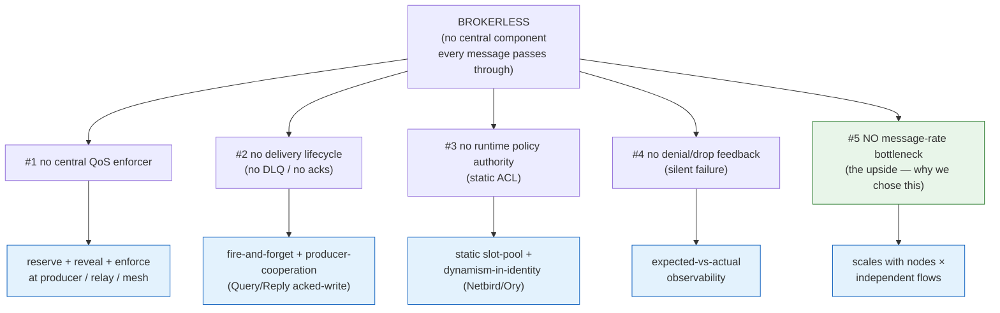

# Brokerless pub/sub — one root, and the consequences we engineer around

> **Why this doc exists.** Several of our hardest design threads — QoS/prioritization, the
> "dead-letter queue" question, dynamic ACL management, silent-denial observability, and the
> message-rate scaling story — look like separate problems but are **the same problem wearing
> different hats**. They are all consequences of one architectural choice: the fabric is
> **brokerless**. This page is the map: the root, each consequence, how we pay for it, and where
> the detail lives. If you've read one of the threads and wondered "why does this keep coming
> up," this is the answer.

---

## The root

The data fabric is **brokerless** — Zenoh peer-to-peer over a WireGuard mesh, with **no central
component every message funnels through**. A broker (Kafka, NATS, Solace, a central MQTT) is one
place that, *for free*, gives you: central **enforcement** (priority, rate limits), a **delivery
lifecycle** (acks, retries, dead-letter), a runtime **policy authority** (dynamic authz), and
**feedback** (it tells a publisher when a write was refused or dropped). We deliberately don't
have one — because that one place is also a single chokepoint, a single point of failure for the
kill chain, and a ceiling on scale (see consequence **#5**, which is *why* we chose this).

The price: **every convenience a broker would centralize, we must re-solve at the edges** — at the
producer, the identity/mesh layer, the relay, and the observability plane. Brokerless isn't
"a broker minus features"; it's "push each function to where it can actually live."

*Each consequence pushes a former broker-function out to an edge: enforcement → the relay + the
hosts; delivery assurance → the producer; authorization → the identity layer; denial detection →
observability. The one consequence that is a **gain** (#5) is the reason we accept the other four.*

---

## The consequences, and how we pay for each

| # | A broker gives, free | Brokerless costs us | How we pay it | Detail lives in |
|---|---|---|---|---|
| **1** | central priority / rate enforcement | no single place to protect mission traffic | **Reserve** a slice (relay, by authenticated identity) + **Reveal** health to all + **Enforce** caps/eviction | [`zenoh-qos-and-prioritization.md`](zenoh-qos-and-prioritization.md) (ADR 1033), [`fabric-health-surface.md`](fabric-health-surface.md) (ADR 1034), [`qos-mission-critical-protection.md`](https://github.com/usareur-af/goatdocs/blob/main/docs/design/qos-mission-critical-protection.md) |
| **2** | acks, retries, **dead-letter queue** | `put` is fire-and-forget; storages are caches, not queues — **no native DLQ** | producer-cooperation: acked-submission via **Query/Reply** for must-land writes; *not* a broker DLQ | F-178, [`zenoh-dlq.md`](zenoh-dlq.md), [`pubsub-best-practices.md`](pubsub-best-practices.md) §9 |
| **3** | runtime, dynamic authorization | the ACL is a **static file, restart-required** — no live policy authority | pre-cut **identity-bound slot pool** in the static ACL; all dynamic decisions (onboard, cut-off) move to the **identity/mesh layer** | F-181, F-156, [ADR 1025](../adr/1025-zenoh-dynamic-tenant-authz-slot-pool.md) |
| **4** | tells a publisher when it's refused/dropped | denial + drop are **silent at both ends** | **expected-vs-actual** monitoring reconstructs "who should be producing vs who is" centrally; producer self-canary locally | F-177, [ADR 1022](../adr/1022-zenoh-denial-observability.md), [`pubsub-best-practices.md`](pubsub-best-practices.md) §9 |
| **5** | *(the broker is the bottleneck)* | **nothing** — this is the gain | fleet message-rate = **nodes × independent flows**, no central funnel; the non-persisted `volatile/` class realizes it | [`zenoh-volatile-class.md`](zenoh-volatile-class.md) §1a (ADR 1032), `goat-net-scaling.md` §"Message-rate scale" |

---

## The through-line

Read top to bottom, the pattern is one idea: **a broker centralizes four functions; we
distribute them to the place each can actually be enforced or observed.**

- **#1 QoS** — you can't enforce priority centrally, so you enforce it *per-hop* (DiffServ): the
  producer marks, the relay reserves by authenticated identity, the mesh ejects abusers. The
  reservation is the only one with real teeth against an adversary; cooperation is the
  optimization on top.
- **#2 DLQ** — there's no broker to hold a failed message, so *the producer* owns delivery
  assurance (acked Query/Reply when it must land), and the platform *detects* gaps centrally
  rather than queuing them. A DLQ is the **wrong category** here — F-178 is the canonical statement.
- **#3 dynamic ACL** — there's no policy authority to update at runtime, so the *credential* and
  the *mesh* (which are built to change live) carry the dynamism; the static ACL only ever holds a
  pre-cut pool of identity slots. Authorization moves to identity, not to a broker.
  **The bill for this is not zero, and it accrues.** Pre-cutting *everything* at boot means an
  unused slot still costs a rocksdb store (~140 KB disk + file descriptors), so pool size is a
  storage-architecture decision, not a config knob — fine at hundreds/1k, but 10k+ hits FD/boot
  walls and forces a prefix-keyed-single-store rework (F-186, [ADR 1025](../adr/1025-zenoh-dynamic-tenant-authz-slot-pool.md) Addendum). The absence of any dynamic-ACL-management
  *utility* is the single biggest standing engineering tax in this construct: every authz change is
  a pre-provisioned workaround, and each workaround carries its own boot-time cost. Re-weigh against
  the deferred custom-interceptor fork (ADR 1025 §7) as pools or sites grow.
- **#4 silent denial** — there's no broker to say "denied," so we *reconstruct* that signal from
  observation (expected-vs-actual). This is the connective tissue between #2 and #3: it's how an
  operator learns a producer was cut off or is over-rate without a broker telling anyone.
- **#5 scale** — and the reason all of the above is worth it: with no central funnel, the fabric
  scales horizontally to message volumes a broker could never carry. This is the upside that the
  four costs buy.

**The unifying rule of thumb:** *if you find yourself wishing for a broker feature, the answer is
almost never "add a central component" (that re-introduces the chokepoint we rejected) — it's
"push the function to the producer, the identity layer, the relay, or the observability plane."*
Every one of the four consequences above is an instance of that rule.

---

## When you're reaching for a broker pattern, check here first

| You want… | A broker would… | We instead… | See |
|---|---|---|---|
| "guarantee this message is delivered" | retry + DLQ | acked Query/Reply submission (must-land only) | #2 |
| "prioritize the kill chain" | central QoS queue | reserved relay slice by identity + per-hop class | #1 |
| "revoke this tenant right now" | update the broker ACL | mesh-evict + the identity slot pool | #3 |
| "know why my publish vanished" | broker error/NACK | expected-vs-actual monitor + self-canary | #4 |
| "carry 10× the message rate" | bigger broker cluster | more nodes / more flows (no central funnel) | #5 |

If a future design proposes a central component to solve one of these, that is the signal to
re-read this page: it is very likely re-introducing the broker we deliberately don't have.
